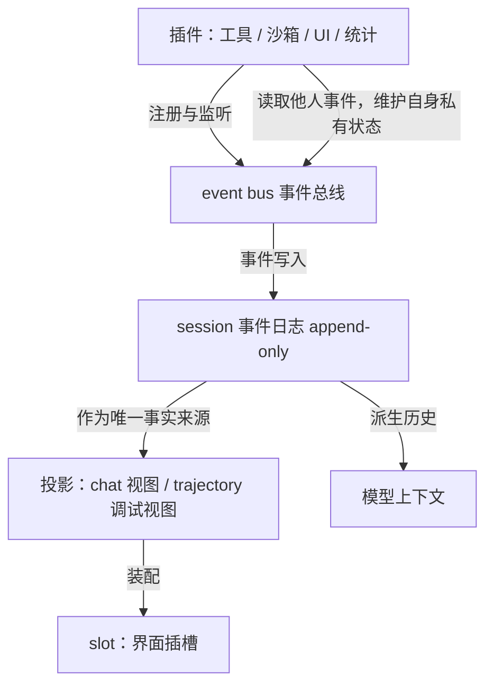
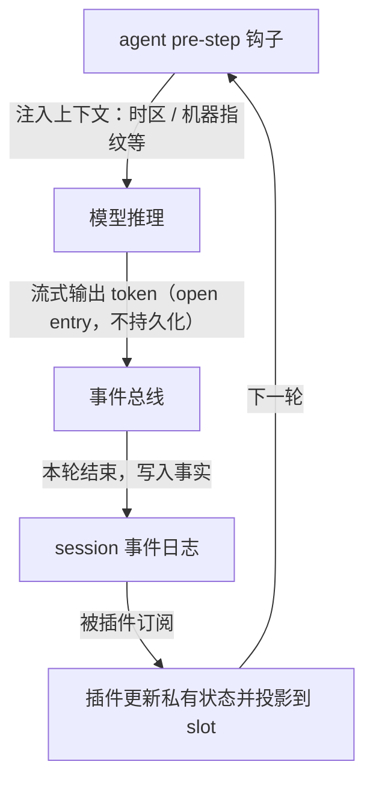

# DeepSeek Harness（一）：需求、架构与生态

**课程**：26 生成式软件工程（NJU）
**原视频**：[DeepSeek Harness (1) [09-Raw/26生成式软件工程/NJU]](https://www.bilibili.com/video/BV144nc6KEA4/)
**时长**：约 89 分钟　**阅读时长**：约 32 分钟（按正文阅读单位估算，非实测）

上一讲用 150 行代码写出了一个能跑的 agent。这一讲换一个问题：如果要把它做成一个产品，会遇到什么。讲师选的案例是 DeepSeek Harness（下称 DSH）——一个把 agent 运行时做成操作系统微内核的开源项目。全程只讲四件事：需求为什么会变、架构在受限与自由之间怎么取平衡、DSH 用什么抽象支撑插件生态、以及这个架构最终能长出什么。

> 说明：本文依据课堂字幕整理。讲师对产品的判断、预测与个人项目披露均按原意标注归属；字幕中明显误转的专名已按上下文校正，个别无法确定的保留疑点。

---

## 一、为什么要在 agent 时代重讲软件工程

### 1.1 你不再是一个单线程 agent

*(参考时间: 00:00:00–00:00:45)*

软件工程、项目、项目管理这些概念之所以要反复重讲，是因为它们在 agent native 时代正在被重新定义。

讲师用了一个身份比喻：你自己上学时是**单线程 agent**（一次只推进一件事的执行者）——学 C++、学 Python、写自己的项目，全在自己一个人的时间线上。而当你开始用 agent，你立刻拥有了一家现代公司的架构：你是 CTO，负责全部，但很可能不写代码；下面有架构、产品、UI、前端、后端好几个 agent；每个 agent 又带多个 **sub agent**（被派出去执行子任务的下层 agent），sub agent 还能再创建更多。这个组织架构不是比喻，是管理复杂需求的必需品——没有它，你接不住一个复杂需求。

讲师提到一个时间点：就在上周，Anthropic 说 Git 已经不够用了。他的态度是“这很自然”：在讲版本管理那一讲时他就说过，总有一天会不够用。

商品最终仍要交付：需要版本控制、需要**仓库**（repository，存放代码与历史的目录），产品还要经过 **CI/CD**（持续集成与持续交付，代码提交后自动构建、测试、上线）才能对外提供服务。

### 1.2 多个 agent 改同一个仓库：锁的类型

*(参考时间: 00:01:26–00:03:05)*

一个 agent 收到的是一个 task。从 first principle（第一性原理，即从最根本的事实出发推理）看，这个 task 一定和仓库的某一部分相关：可能重构某个 subsystem，可能在某处加功能，可能影响若干模块。不同 task 在系统里“覆盖的形状”不一样。

讲师设想给这些操作加**锁**（先占住一块区域，避免别人同时改动），而且锁应该有类型：

- 只读锁：只是看，不改；
- 写锁；
- 重构锁。

关键判断是：一个小的 fix 虽然是写锁，但不产生 **breaking change**（让已有调用方或结构失效的改动），所以多个互相独立的小 fix 完全可以并行执行。

可以借鉴的既有方案有两种：操作系统式的“先上锁”，以及数据库式的“先做、再做冲突检测”——即**乐观并发**（先各改各的，提交时检测冲突，冲突才回退）与悲观并发之分。讲师明确说，这套方案目前还没有真正用起来；但他认为答案会随着组织架构的清晰而慢慢浮现，而世界正在朝这个方向推进。

### 1.3 选 DeepSeek Harness 当案例

*(参考时间: 00:03:12–00:06:16)*

概念讲得差不多了，就该落到具体项目上：如果真要设计一个 AI native 时代的产品，整个流程会是什么样。

讲师选 DSH 的原因很实际：他前天在北京参加了 DSH 的线下聚会，到场很多是与在座同学同龄的开发者。他们不像讲师那样写过很多代码、经历过“古法编程”时代，很多是对着网页**许愿式编程**（把需求说给模型，让它自己想办法实现）成长起来的；但这批人几年后很可能成为核心开发者。所以要讲清楚：从零开始构建一个 agent harness，会遇到什么问题。

本讲覆盖需求、架构，以及“在 DSH 上做二次开发”时整个软件系统的设计。下一讲再讲 agent native 开发更细的部分。

讲师也提前解释了一个常见困惑：网上有很多 skills，可以 grow 出各种能力、看起来有 super powers，但真正拿来用时，会发现 agent 陷进无穷多你不想让它管的事情里——尤其面对未知时你不知道它在干什么，有时它会疯狂派 sub agent 做你觉得没必要的测试和 validation。这些行为在公司真做产品时可能成立，但最好自己摸索一遍，有切身感受。

本次演示环境是他已经编译好的 DSH，运行方式是纯许愿式的：从部署到外部对接，只确认“这个项目可以被编译”，剩下交给 agent。

---

## 二、一个能跑的东西离产品有多远

### 2.1 一句话生成南大仙林三维模型

*(参考时间: 00:06:16–00:10:01)*

起点是上一讲的 mini agent。几乎所有 agent harness 都遵循同一个循环，因为大模型推理是 request-response 式的：一问一答，不管回答方是人还是工具。

这个 mini agent 能用，而且能做不 trivial 的任务。讲师在高铁上给了一句话需求：要一个比例基本真实的南大仙林校区三维图。结果超出预期——虽然有些地方不对（计算机楼是十层楼，高度明显做错），但图书馆建模相对较好，俯视的几何形状被正确保持了。

它是怎么做到的？讲师看了 agent 的 trace（执行轨迹）：网上有大量数据源。他上学时就发现过一个宝藏网站 **OpenStreetMap**（开放协作的世界地图数据库，可自由下载矢量地图），细到连一个篮球场的边线都会画出来。agent 从这里爬数据，再按自己的想法建模：地图上没有信息的区域被标成绿色，它判断是绿地（可能有小公园或休息座椅）；大门也被建成了楼，门口铺满了树。

改进路径也清楚：给它更好的提示词——把每一块区域单独划定，先思考这块区域的功能应该是什么样，再做精确建模。代价是大约十倍 **token**（模型读写文本的最小计费单位，多轮反复迭代就多烧算力），换来一个明显更好的版本。

网上很多三维生成效果用的是同一套路：靠 skills 追着 agent 一遍遍验证，烧 token 在“还不错”的基础上继续修。讲师说，这类模型已经可以作为做“南大版 GTA”的起点——你知道哪里可以走人、哪里可以蹲点，游戏逻辑就能搭起来。

但结论是：**它能课上玩一把，不能作为产品。**

### 2.2 断网：mini agent 缺的那三件事

*(参考时间: 00:10:01–00:11:11)*

原因在上一版的一个隐含假设：它假设网络服务不会中断。只聊一两轮，你感受不到；但讲师在高铁上跑了一段较长时间、已经有中间结果时，网断了——进程直接终止。而那 150 行代码里没有会话保存，没有恢复，也没有断网重连。他只有两个选择：从零继续，或者整段重做。

这属于 **accidental complexity**（偶然复杂度：问题本身不难，是工具与环境逼出来的额外复杂度）。一旦要做一个真正的 agent 产品，第一件要应对的就是 API 中断，也就是你天天在 coding agent 里看到的各种重连行为。

### 2.3 重试为什么是设计问题

*(参考时间: 00:11:11–00:12:41)*

重连听起来简单，往下追就变成一系列选择。

**间隔**：在美国的数据中心直连 OpenAI 服务，和在国内叠多层代理访问，是完全不同的网络环境，**timeout**（等待多久算超时）和重试时长都不一样。

**退避方式**：第二次重试该用等间距，还是逐步拉长？网络里有个成熟特性叫**指数退避**（失败后按 1、2、4、8 秒这样成倍拉长间隔再试）：既然 1 秒后失败、再 1 秒后还失败，那大概率下一秒仍然失败，所以应该等 2 秒、4 秒、8 秒，一直退到分钟级。讲师自己的物理断网场景，恢复可能需要两三分钟。

讲师还让 AI 帮忙总结过这个话题，AI 又列出了一堆更细的坑。而真实产品里的挑战比这更大。

### 2.4 断网下的支付：未知状态

*(参考时间: 00:12:41–00:14:30)*

最典型的例子是客户端与服务端不一致。

客户端发起支付请求，服务端收到后要和别的系统确认（银行、航空公司），它等不了你把所有事做完再关事务：钱付给银行或航司的那一刻，**事务**（一组要么全成功要么全失败的操作）就已经在服务端 **commit**（提交生效）了。服务端有很复杂的架构保证订单可靠完成，但问题出在客户端：订单发出去以后，手机断网了。

这时应用不能崩，它得转圈，得告诉你网络中断；但这个订单处在一个“我不知道”的状态——可能成功了，也可能失败了，因为缺少与服务端的同步，客户端无法判定自己到底是什么状态。

这就是 **essential complexity**（本质复杂度：业务本身固有的复杂度，写得再聪明也消不掉）。软件系统设计里，这类复杂度躲不掉。

### 2.5 产品级需求清单与 slop

*(参考时间: 00:14:30–00:17:49)*

那么一个 agent 产品到底要做多少东西？

讲师的做法是让 AI 假装要做一个交互式 agent 产品（他举例说可以对标当时最火的 **WorkBuddy**），看它会写出什么需求。结果 AI 先想到了典型场景与用例图，比如“把这个文件夹里本周的项目记录整理成周报、列出延期事项、生成 Word 文件”——这是普通人办公时非常常见的需求；然后开始疯狂列需求点：

- 历史检索与任务复用；
- 模板与偏好；
- 执行预算与用量；
- 账号与数据管理；
- 外部内容与指令隔离；
- 用户反馈与问题诊断。

而且实际上还会多得多，此外还有大量**非功能性需求**（性能、安全、权限、成本这类不属于具体功能的约束）。

如果直接让 agent 去实现这份需求，大概率会陷入 **slop**（讲师用词：量大、能跑、但缺少判断的粗制实现）。原因是 agent 有一个非常强的倾向：直接把任务完成，不花脑子想未来还会发生什么。

所以**做一个产品和做一个 MVP 是不一样的**。但 MVP（最小可用版本，用最少功能验证需求是否成立）有它的价值：用 MVP 时你的假设会不断被验证。讲师那个 mini agent 就做了一个不切实际的假设——网络稳定、API 稳定；假设不成立，需求就相应膨胀了。

---

## 三、需求：真正的敌人是需求改变

### 3.1 改需求三次

*(参考时间: 00:17:49–00:19:55)*

所以设计 agent harness 面对的真正的挑战，不是把当前需求做完，而是**需求的改变**。

讲师构造了一个场景：你已经按办公场景写了一份面向 WorkBuddy 的详尽需求报告，带着 AI 写了 50 万行代码，并且上线了。然后 GrokBot 火了。

GrokBot（xAI 2026 年推出的多智能体产品，把 AI 当同事）带来一种新交互：把 agent 当人。当人对待，每个人就有自己的记忆，于是可以拉一个群让两个 agent 协同完成工作，也可以规定谁每天什么时间做什么。

这时你发现，原来那份详尽需求的前提全废了。原需求定的是左边栏放项目、右边栏放几种视图（pinpoint view 之类）。老板说下一版照 GrokBot 做——“怎么杀死一个程序员？改需求三次就够了”。因为之前所有需求都建立在那个交互模式上，而**交互模式的根基崩塌了**。

这也解释了大厂的行为：不管它把架构做得多好，性能做到极致，功能性与非功能性需求都极好地满足上一版设计，一旦这种摧毁性的变化来了，它必然要开始疯狂拉通对齐、闭环沉淀复用，再到下一个版本。这没办法——大厂有交付质量要求，它做了一个选择：优先保证极高质量交付，所以架构会相对保守。

### 3.2 GrokBot 与 DSH bot 的光速复刻

*(参考时间: 00:19:55–00:22:10)*

对比之下，DSH 生态的反应速度是另一种景象。

GrokBot 火了之后，很快有不止一个人发布了 DSH bot：界面**像素级复刻**——可以设置多个 bot，可以拉群，群还有群图标，可以和 bot 聊天。讲师认为在这之上还能外挂它没有的功能：

GrokBot 面向普通人，所以不开放任何编辑配置的权限。但对程序员来说，就想把配置文件拿出来自己改一下，或者把提示词拿出来改一下——“因为我懂得怎么改提示词，而 99% 的人不知道怎么跟模型对话”。GrokBot 是很成功的产品，但你不满意就可以“许愿”加上别的功能：比如一个 multi agent 交互的 dashboard，让你以老板视角管理，左边栏不是项目树，而是代表你所管理部门层级的树状结构，右边的聊天压缩小一点，甚至给你一点“坐在办公室里的老板”的情绪价值。这类需求很快也有人实现。

讲师说这个故事的用意在于：同样是需求变化，一边是拉通对齐，一边是光速复刻，差别来自架构给了多少自由度。

### 3.3 2026 年 6 月 10 日晚 11 点

*(参考时间: 00:22:10–00:23:32)*

时间倒回 2026 年 6 月 10 日。那时 coding agent 已经让大家意识到要变天了，主流产品有 Claude Code、OpenCode 等；还没有 WorkBuddy，有 CodeBuddy（讲师后来得知两者共享同一套 agent 层编排的底层架构）。

当晚 11 点，一个神秘项目启动，仓库里什么也没有——“谁说 DeepSeek 不加班的”。连当时为了同时支持多种 agent 而需要的 CLAUDE.md（放在仓库里告诉 agent 项目规则与命令的说明文件）都没有，这本身是个很麻烦的需求点：项目要同时支持多个 agent，就得用它们都理解的方式组织文件。好消息是今天已经不必依赖它了。

而它的第一份需求分析（一份 link 进去的 MVP requirement analysis）里就写着一个 **microkernel**（微内核：内核只做最小调度，其余能力全部外挂成可替换模块）架构。**从第一天起，它就想做一个操作系统，想造一艘航母。**

---

## 四、架构：受限与自由之间的取舍

### 4.1 对着需求做架构会得到什么

*(参考时间: 00:23:32–00:25:00)*

如果直接对着需求文档让 agent 设计架构，会发生一件很自然的事：agent 的注意力落在需求上，而它不能交一个空架构（那等于没完成任务），于是会为需求里的名词建结构。

比如需求里有个“工作区”。agent 就会为工作区做一个 class，再去补工作区和其他东西的交互：和模型、和 agent 层怎么交互；工作区里可以链接 session；session 可以向 agent 发 chat；agent 之间可以调用 agent loop 或工具做事；工具的结果（比如画布的绘制结果）可以放回 session 上；session 的数据该存数据库。

于是架构开始出现模块、出现数据库、出现消息队列。这是非常自然的架构设计方式，大厂也经常这么设计。

但讲师强调：**架构意味着没有免费的午餐。** 任何设计都是在受限和自由之间达成的平衡。

### 4.2 边界的好处与代价

*(参考时间: 00:25:00–00:26:03)*

架构确定，模块之间的边界就有了。边界带来的直接好处是：开发某个模块时，不必（或只需少量）知道系统其余部分怎么工作。

于是第一天就能把需求切进这个架构，每个模块独立开发，**立刻可以启动大量 sub agent 并行把产品堆出来**。

代价是自由度：你做的这个限制，限制了未来。当 GrokBot 那样的需求出现时，如果架构适应不了，就会不断出现**抽象泄露**（原本封装好的细节被迫漏出来，调用方不得不关心它），项目很难维护下去。

### 4.3 太自由等于没有架构

*(参考时间: 00:26:03–00:28:01)*

反过来，做得太自由也不行。讲师假设有人要做“创新架构”：每个模块都是一个 process（进程），工作区、session、agent、UI 各是一个进程，进程之间全靠 **message passing**（消息传递：模块之间不直接调函数，而是发消息通信）。

这个架构看起来很干净、很自由，随便发消息。讲师说：这确实**就是个 actor model**（每个单元都是独立进程、只能靠收发消息协作的模型）——说得对，可能确实能这样实现，但它没有约束：消息怎么管理、什么时候发什么消息，全都没有规定。

对比之下，前面那种架构规定了工作区和 agent 之间通过某个 API、某个队列（比如 session 的消息队列）交互。接口一确定，就只能做这件事，反而容易开发。

**越容易、越自由的东西，越不好开发。** 受限有受限的好处，自由有自由的好处。

### 4.4 老案例：进程、语言、LAMP

*(参考时间: 00:28:01–00:30:01)*

同样的取舍在软件史上一再出现。

进程是一个非常好的抽象，非常自由——正因如此，上层才能搭建各种应用：浏览器、coding agent、虚拟机。但自由也有代价：光“操作系统该用什么语言开发”人类就吵了几十年，当年“PHP 是最好的编程语言”这个梗流行了很久；高级语言越自由（比如 C 能更好地控制机器），就越可能带来内存泄漏这类麻烦。受限与自由无法两全，只能在光谱上取一个位置。

再比如经典的 **LAMP**（Linux + Apache + MySQL + PHP 这套建站组合）架构，它引领了整个互联网世界至少十几年，WordPress 就是典型代表。它很好——在单机还能处理应用需求的时候，它就是最合适的架构，PHP 就是最好的语言。但当你需要服务 1 亿人、10 亿人时，这个架构就扛不住了：从单机到数据库，**每一个点都是瓶颈**。为了拆开，就分库分表，再拆服务器，一路都是抽象泄露，最终演进到下一代架构。

### 4.5 event sourcing 的代价：强行毕业

*(参考时间: 00:30:01–00:33:21)*

**event sourcing**（事件溯源：只追加记录发生过的事件，当前状态由事件重放算出来）是个概念非常干净的架构：所有东西都是事实，只做追加记录，其他人看到的都是事实的派生。它给你解耦、给你持久化、甚至可以回退到任何历史版本。

但它不是没有代价的。因为当前状态完全由过去的历史推导出来，想让性能做好难度更大。

更麻烦的是一种真实需求：有时候我们真的只想 hack 当前状态。讲师举例：教务员就是想让你强行毕业，没有理由。在一个月黑风高、没人知道的时候悄悄操作一下，你就毕业了——这在真实世界里可能是个合适的需求。但在 event sourcing 里很难办到：你必须加入一个特殊的 event 和特殊的处理规则，叫“强行毕业”；而这件事因为写进了持久的历史，会被审计到，你又不能用“我也不知道当时怎么回事”来搪塞——因为谁 committed 这个 event，当时就知道。

所以每个架构都有取舍：牺牲一些，换来解耦的系统、持久化、可回退。

### 4.6 MapReduce：用限制换规模

*(参考时间: 00:33:21–00:38:19)*

总原则是：**架构和需求匹配时就便利；假设发生变化时，架构就可能成为阻力。** 讲师由此延伸：人类社会的进步，某种程度上就是不断打破旧假设的过程——新产业诞生、旧产业消亡，新旧交替时有人才流转，也有人被淘汰（他举了国企改革、房地产、互联网到云计算再到 AI 的历次浪潮）。而 AI 是产业超级加速器，这个变化会更有趣。

接下来是一个具体的架构变化案例。2004 年，Jeff Dean 与 Sanjay Ghemawat 发表了一篇改变世界的文章：MapReduce（大规模集群上的简化数据处理）。文章非常好读，只看例子就够了——要做大规模分布式计算，你不用写很长很长的代码，只要遵循一个受限的代码模式：map 和 reduce。这也是函数式编程里的概念，Python 里就有。

- **map**：有一个 list，再有一个 function，就能把它变成另一个 list；
- **reduce**：拿一个 function，不停地用前一次结果和下一个元素计算；如果这个 function 有好的数学性质（比如结合律），就可以并行地 reduce 两个部分，再 reduce 它们的结果。

只要能把计算写成这个形式，就能用它的框架。它做了一个架构上的取舍：**限制你的编程模型**——你只能先 map 再 reduce。同时它做了很多聪明的系统设计：reduce 前会把中间结果按 key 排序（shuffle），剩下的系统实现藏在后面，你不需要知道。早期 Google 内部是 C++ 的，include 一个头文件，写个 class 说明 map 和 reduce 是什么就行；你用的抽象不再是 pointer、list，而是系统包裹好、可能跑在不同机器上的那层东西。你只需要声明：要 map reduce，最多 2000 台机器，每台每任务 100MB 内存，跑吧。

它解决了 Google 最大的痛点：机器一多，系统就不可靠；跑一次全互联网数据的索引，几乎一定会有机器掉线或故障。以前的基本假设是“机器是好的”——你在自己电脑上做大作业，机器不会突然消失；就算消失了，你还能用社会工程的方式找老师解释。Google 不能用这种方式解决问题，它必须用系统抽象解决。

它也失败了。因为这个限制只适合离线任务：用起来不那么方便；而当实时数据（比如银行订单）也走向分布式时，MapReduce 就撑不住了，于是有了 Spark 这样的计算引擎和 Flink 这样的流式数据处理。

---

## 五、DeepSeek Harness 的架构

### 5.1 Everything is a plugin

*(参考时间: 00:38:19–00:40:10)*

讲完这一串取舍，回到问题：如果要设计一个 agent harness，first principle 是什么？

DSH 的答案是操作系统式的：操作系统不需要知道每个进程在干什么。UNIX 诞生时还没有桌面浏览器，也没有图形界面，它不需要管这个进程做什么，但它能把这些进程组合起来，让进程之间互相组合、互相使用。

所以它的 first principle 是 **Everything is a plugin**（一切皆插件）：所有东西都可以插件化解耦。

如果你把每个插件想象成一个进程、一个人，让它们之间互相发送消息，理论上就能实现任意架构。这个架构真正的要求是：把每个模块的 **private state**（私有状态：只属于该模块内部的数据）封在自己里面；模块之间需要交互时，发一条消息，得到一条返回。

由此可以推下去：任何程序的任何模块都能被提取成“进程”，把模块之间的函数调用换成 **RPC**（远程过程调用：像调本地函数一样调远端进程的函数），任何软件都会变成这个形态。

### 5.2 Cordis 管什么

*(参考时间: 00:40:10–00:41:41)*

讲师特别区分了两层：DSH 底下的插件内核叫 **Cordis**（DSH 的插件框架，只负责插件加载、卸载与依赖管理），它在 DSH 之前就有一篇论文，里面有大量公式；本讲不展开这部分。

Cordis 负责的是服务的解析、依赖的激活，以及这些插件的 load 和 unload。

如果把 DSH 想成操作系统，那上面的东西就是进程。操作系统里该有进程管理：一个进程退出时，它持有的所有资源都应该被回收——这是一件大家默认了很久的事，就像写 C 程序从来不回收内存，因为知道操作系统会回收。

Cordis 的设计也基于这个想法：理想情况下，一个插件可以声明它需要哪些资源、对系统会产生哪些 **side effect**（副作用：装上后对系统造成的改动），这些依赖应该被自动加载；当插件 unload 时，依赖的东西最好能自动卸载。讲师也承认，肯定不是所有副作用都能回收。

### 5.3 真正的难点是协同

*(参考时间: 00:41:41–00:43:41)*

但整个 harness 设计真正的难点不在加载卸载，而在**协同**。

如果插件之间可以随便发消息、随便协同，那就全乱了，跟把每个模块做成函数、链接在同一个地址空间里没有区别，没有任何实际好处；可不协同又没有用。

所以真正有意思的设计，是要构建一个 **agent harness 的世界模型**：有一个所有进程共享的共享空间，关键的数据结构都存在这里。

DSH 没有特权内核，所有东西都是 Cordis 的插件；但在 Cordis 之上有更细一层的世界模型，比如 Cordis 下面的 session。

### 5.4 session 事件日志是唯一事实

*(参考时间: 00:43:41–00:45:00)*

做 LM（大语言模型）agent，应用无论如何还是以模型为中心。所以 DSH 里 session 的 append-only 事件日志是唯一的 **ground truth**（唯一可信的事实来源）；模型的历史不单独存储，而是从事实消息里派生出来——这就是 **event sourcing**（事件溯源）。

也就是说：它有一份完整的事件日志，在进程基础上又做了一个 **event bus**（事件总线：所有插件共用的消息通道，可发布、可订阅），总线上面可以挂载各种插件，插件也可以监听总线上的事件；在这个“世界”之上，是一份持久的历史，其他所有能力都在这个地基上长出来。

围绕这套事实，还有几层配套机制：

- 类型检查，以及服务的定义方（provider）与使用方（consumer）；
- 一系列权限管理；
- 最重要的是**事件即扩展点**，且按领域分类：每个插件都可能产生事件放到总线上，规则主要规定消息格式是什么、谁能往总线上放、类型是否匹配——不匹配的话 TypeScript 直接不会编译这份代码，相当于禁止你任意往别人那里发消息；
- 插件不仅能监听事件，还能收到事件后修改事件本身。

由此 DSH 给插件提供的就是一组原子能力，像一个小操作系统：每个插件都能在总线上看到 LM inference 的状态（比如这次吐了多少 token）、看到别的插件做了什么。

下面这张图是这套分层的形状——插件不直接互相调用，而是通过总线和事实日志协作：

图依据 00:42:21–00:48:31 内容整理。实线箭头表示“注册/写入/派生出视图”的实际方向；插件的私有状态留在自己内部，只有希望别人看到的事才以事件形式放到总线上。

### 5.5 open entry 与 slot

*(参考时间: 00:45:00–00:47:20)*

有两个实现细节很能说明这套设计的取舍。

**open entry**：模型这次推理还没结束时，状态不 commit 到历史里。history 里可以有一个 open entry，表示这一轮尚未结束；模型不断往里送新的 token，这个状态不持久化，但仍然可以被观察到。正因如此，界面才能实时显示思维链的动态变化（演示里那段不断滚动的 thinking 就是这样来的）。讲师把它称为实现层面的一个小 trick。

有了可观察的 token 事件，插件就能统计 token 成本与 cache 命中情况，再通过 **slot**（界面插槽：UI 上预留给插件填充的位置）绑定显示出来。

**两种投影**：同一个 session 历史可以投影成不同视图。聊天窗口本质上是 message history 的一个投影，可以投影成给人看的 UI；也可以投影成给开发者看的 **trajectory**（执行轨迹）。在 trajectory 里可以调试每一次工具调用：payload 是什么、干了什么、结果是什么，还有一些额外信息。

### 5.6 白板一块如何长出生态

*(参考时间: 00:47:20–00:50:00)*

内测最早的时候，这些能力都没有——就是白板一块，真的什么都没有。但就在第一天，开发者群里有人提出“来一个 token 统计吧，上下文的统计”。

这个插件完全不需要干扰系统里任何一个其他部分，因为它是**不侵入**的：只要观察 event bus 上 LM 吐 token 的情况，相应更新自己内部的状态即可。

这背后是一条清晰的原则：**希望把大部分状态都放在插件自己内部，只有希望别人看到的事情，才以事件的方式放到总线上。**

为了让这套抽象支撑 LM 场景，DSH 做了更多专门化：session 是事件列表；agent 接收输入、推动执行；UI 有用于装配的 slot。有了这些，你在 WorkBuddy 里想要实现的东西基本都能做出来。

讲师由此给出判断：如果第一方把 event 的设计、session 的设计做崩了，整个 DSH 就维护不下去；反过来，如果概念体系建得很好，使得上面的插件绝大部分时候只需要消费极少量、对系统没有侵入的事件（虽然它们具备侵入能力），那就可以在上面实现任何东西。

### 5.7 一组很小的 API

*(参考时间: 00:50:00–00:53:23)*

对外暴露的接口很小：

- 在 session 上 append；
- 注册某个 event 的 handler，在 event bus 上监听；
- 从事实生成投影：session 的 message、导出的 agent trajectory、chat；
- 向 agent 提交输入，可 follow up、inject、steer。

其中 inject（把新内容插入正在进行的推理）的时机本身就是设计问题：是等这一轮工具全部完成再注入，还是每次模型 response 之后就立刻注入，还是按 ESC 停下来再来。

更关键的能力是：`session.event` 可以 hook 尚未 persist 的事件。插件不只是旁观者，也不是“看完再推一个自己的新事件”，而是可以拦截、丢弃、改写事件。

典型用法是在 agent 的 pre-step 之前挂一个 hook，往 agent loop 里注入 prompt。讲师举例：如果希望每一轮都把当前时区、机器指纹这类信息注入模型上下文，这件事本来写在 build context（构建上下文）里也能做，但在 pre-step 挂钩子上做，就等于把这段逻辑变成了一个可插拔的插件。

图依据 00:45:00–00:52:45 内容整理。箭头表示执行先后与数据流向；其中“流式输出”这一段不进入持久历史，只作为可观察的临时状态存在。

总体上就是：**插件挂在总线上，只有少量协作接口，每个插件的绝大部分状态留在本地**；但因为它们能感知全局的 agent loop、session 以及各种投影，所以每个插件都能按需拿到关于“推理进行到哪一步、别的插件做了什么”的信息。

### 5.8 同一套事件，换一种界面

*(参考时间: 00:53:47–00:55:43)*

DSH 原生是 Web UI，关键抽象是装 UI 的 slot——Web 能呈现人类友好的界面。

但如果你偏要在命令行里用，那 Text UI 就是：把所有用于装配 UI 的 slot 全扔掉，只保留 session、agent，以及在 event bus 上能听到的所有 session 相关事件（包括那个正在吐 token 的 open chat completion），然后把它们投射到自己的终端上。整个 Web UI 一行都不用改。

甚至可以做一个“共享状态的 TUI 克隆”：主界面在跑的时候，另一个终端能看到一模一样的内容。

内测早期官方仓库里其实有 TUI，后来被移除了，现在是第三方在维护。PDF reader 这类插件也是同一个套路：hook 生命周期事件，看到某类内容（比如加载）时把自己注入进去。

### 5.9 Creator 模式

*(参考时间: 00:55:43–01:00:10)*

讲师说，这些还不是插件生态真正好玩的地方。真正好玩的是：**如果让你来做，你想做什么插件？**

有人会说，这不就是一个 Codex、OpenCode 吗，全都长这样。讲师的回答是：你能干任何事。

比如把 DSH 武装成一个像 VS Code 的东西。VS Code 的基本假设是一个工作区（一个目录），左边栏可以动态配置很多小块边栏（editor、browser），也有自己的插件生态。为什么不能做一个？插件内部的状态归插件自己管，一个插件可以维护好多 UI 状态；要打开工作区、要一个终端、要 git、要 side chat，都只是不断观察主 session 并维护自己的状态而已——这跟整个插件生态里任何东西都不冲突。

这正是 DSH 与“预先定好需求”的产品最根本的差别。GrokBot 那样的产品是：我有一个预先定好的需求，请所有人都在我的需求里工作。而 DSH 专门给了一个 **Creator 模式**，它给的是 Cordis 的权限。

普通 agent session 只有 agent 权限：工作目录读写、Bash，外面还套一层沙箱。而在“全火力全开”的 Creator 模式里，它是能看到这个世界的：可以把插件拆了，可以往里面加插件——也就是说，agent 一边运行，一边就能往 event bus 上挂东西。这个能力来自 Cordis 的全动态插件生命周期，就像操作系统里可以随时启动一个进程，也可以随时杀掉一个进程。

所以讲师的评价是：**看起来它是一块白板，实际上它是一颗核弹。** 为什么不许愿式地做插件呢——你发明了 Creator 模式，就可以许愿。

---

## 六、生态的代价与两个方向

### 6.1 语义冲突：插件不是万能的

*(参考时间: 01:00:10–01:05:24)*

所有好处都是有代价的。代价在哪里？

事件层做了统一对齐：大家都使用同一组事件，类型不匹配就不行。但**所有状态的管理，也就是插件自己的状态管理，还在插件自己手里**——比如那个把界面做成 VS Code 的插件，窗口长什么样、终端怎么表示，都在它自己内部。它当然也可以造一个自己的事件推到总线上让别人看到，但**插件和插件之间的语义可能是冲突的**。

举两个例子。

一是数量叠加。可以实现一个上下文压缩插件，把每一次上下文输出压到 1/2。但如果你加载了十个自动压缩插件，每个都压到 1/2，那 1/2 的十次方大约就是千分之一，任何输出都被压到不能看的程度，信息全丢了。

二是顺序与意志冲突。一个插件检查输入、另一个插件改写输入，到底检查在前还是改写在前，架构没有规定——这是与应用语义相关的事。两个 hook 一个要求停止、一个要求继续，它们本身就是冲突的，而当 hook 运行到“停止”那里，流程就被停掉了。

讲师把这归到 essential complexity：这类语义冲突永远没办法由这种架构解决，可能需要另一个机制，比如再放一块 **blackboard**（黑板：一块共享状态区，多个模块读写同一份数据来协调），需要的时候大家再去共享状态。而一旦有这种需求，抽象就开始泄露了。

结论是：**插件不是万能的，架构也不是万能的。** 插件只是减少了一部分 accidental complexity，让动态 UI 生成这类事情变容易了。

### 6.2 发布一个 nothing

*(参考时间: 01:05:56–01:07:40)*

前面一直讲的是一个简化模型：做出需求，产品 release 出去，然后就挣钱了。

DSH 走了一条不太一样的路线：它 release 的时候，**release 了一个 nothing**——只给了一些基础抽象和少量第一方插件，剩下的交给了开源生态。

于是外部成本低，生态能长出来：上周北京有一场完全由开发者自己组织的活动，官方没有任何人到场（讲师因为正好去北京，顺路闪现了一下）。

但讲师坦言，他感觉开源社区的开发者有点被“带歪”了：如果他是第一方，可能不会拿这么好的底座去许愿一个高达驾驶舱。他承认大学生有时间、脑洞多（把侧边栏做得更好的 Better Sidebar 就是个很好的想法），但他自己会拿去做更了不起的东西。

在他看来，这样一条 event bus 真正的能力，不在于接那种 fancy 的小东西（hook 一个事件、把 UI 增强一下），而在于**一整个生态**：工具可以进来，工具之间还可以互相组合。

### 6.3 方向一：超级应用桥接

*(参考时间: 01:07:40–01:12:30)*

第一个他想接入的是**超级应用**（SuperApp，指 WPS、Office、Blender 这类功能完备、能嵌在网页里的大型应用）。讲师估计只需要一个非常小的抽象层，但对它本身要做一点改造；没有 Web UI 也行，可以用一个 **bridge**（桥接层：把外部应用里的对象与操作接到 agent 上）连起来。

这个 bridge 只支持三步操作：

1. 把一些对象锁住——比如我在做幻灯片，第一页、第二页别编辑了，现在锁住第二页；
2. 把对象 hand off，从总线上送进模型的上下文；
3. 把模型改完的对象从上下文里拿回来，替换回应用里。

只做这样最小的改造，就给一个超级应用赋予了 AI 原生的能力，而且它能享受到 DSH 插件生态里所有东西的好处。讲师说这能力“非常恐怖”：DSH 是一个非常小、非常薄、什么也没有的内核层，但它底下有一整个大的插件生态。

他用 Excalidraw（一个可嵌网页的手绘风格白板）花了 5 分钟做了演示：让 AI 在框里画一只 turtle（乌龟），此时所有编辑照常可以进行，但被锁住的对象动不了；模型把对象拿走后生成内容，再回填。演示里不满意的地方可以再改，甚至把画得不合适的龟壳删掉——因为对象回到了本地应用，人可以接着编辑。

讲师还把它和另一种产品思路做了对比：有些 AI 做 PPT 的产品（他提到 Kimi 这类），自己做完 PPT 后，产品团队还要再做一个 PPT 编辑器，让用户拖框、加注释、再让 AI 改。他的疑问是——为什么不反过来做？直接把这个生态“摁进去”就完了，这才是真正的 AI native：所有东西都可以编辑，不满意可以改，不满意可以删。

这也解释了它与 MCP 的关系：只需要做一个非常小的 protocol（协议），甚至这个 protocol 本身可以成为 DSH 的原生插件，专门做对象的桥接。用同样的方式还可以做 Blender 的 bridge。

讲师后来核对过这个插件的实现，总结出两条关键设计：**工具调用不直接改画布，只是暂存**；`begin` 时生成一个 job，把选区 id 锁在画布上。对应关系是——**画布等于 session，编辑请求等于 tool call，提交等于回合结束的 commit**。整个改造相当于一个非常薄的应用改造层，把应用做成了 agent 宿主插件，对应用其他部分几乎没有侵入。

### 6.4 方向二：生成式 UI

*(参考时间: 01:12:30–01:19:00)*

第二个方向利用了 event bus 可以随意 hook 的特性：建立一个 session 与模型之间的双向通道。

只要允许模型输出一个带 HTML 加 JS 的卡片，就能把这张卡片放到界面的任何 slot 上。关键在于卡片里有 JS：这意味着可以放按钮、放输入框，理论上甚至可以嵌入 Excalidraw、WPS，或者写一个非常复杂的组件。

再允许某些 JS 往 event bus 上注入事件，就能把 UI 里的点击与状态重新注回模型上下文，模型据此再指导 UI 更新。讲师说，这不就是一个 **generative UI**（生成式 UI：界面本身由模型按需生成）的应用吗。

实现只需要一组约定：约定某个标记（讲师演示里是一个带特定名字的 div），只要模型输出里出现这个标记，就把它当成卡片渲染。剩下的就是许愿——跟插件说“我要做这个事”，它会生成一段带 JavaScript 的代码。

演示有两个：

- **成语接龙**：以“惊弓之鸟”开局，点击按钮后，JS 往上下文里注入一句话（就是字符串拼接），模型接“鸟语花香”，然后生成一个界面的 patch。
- **五子棋**：棋盘状态放在 UI 里，但所有落子都由模型思考之后决定。

当前实现有明显缺陷：因为讲师为了快把思考关掉了，出现过状态不同步、棋子下到线上的 bug。他明确说这肯定不是一个成熟的产品。

但他请大家回想 GPT-3.5 的 ChatGPT 时刻：当时让它从 50 数到 100，它会一直重复 51；你会觉得这东西又慢又不好用。可是当你看到一种可能性、看到它“能做到一点”的时候，就意味着一定有办法可以做得非常非常好。

这条路还能和上下文相关的插件配合：怎么做上下文压缩、怎么做上下文管理、甚至上下文的 fork（分叉），一方面省下上下文，另一方面让交互更有效。极端情况下，连聊天框都可以不要——面对一个任务，直接生成一个真正好的生成式界面。

---

## 七、闭环与展望

### 7.1 插件实现里的两条纪律

*(参考时间: 01:19:21–01:25:03)*

讲师在演示的末尾做了一件更值得学的事：先许愿达到预期效果，再让模型告诉自己**这是怎么做到的**，然后深入到架构里看插件的实现到底有多侵入。

结论是没有侵入，而且 DSH 通过 **scope**（作用域）机制在机制层面做了限制：插件如果想干一些坏事，它匹配不上自己所声称的东西时就会自动 fail，相当于被隔离开。这个插件同样只注册了一些事件，比如旁听全局的 assistant stream 事件；它还做了一个对象同一性过滤——别的 agent 的事件匹配不上，就不理会；需要时在后台启动一个 inference session，只从里面取结果回到画布。

讲师说明，这些插件之间没有刻意做组合，因为他完全是许愿式做出来的；而在真实产品里，插件能力的组合才是关键。

### 7.2 个人数据库替超级应用填表

*(参考时间: 01:25:03–01:28:17)*

把前面两个方向合起来，就是一个闭环案例。

讲师说自己是**用 agent 管理个人数据库的**。于是他做了这样一件事：接一个自己的 database 插件，这个插件可以向模型提供必要的信息——个人信息、发表过的论文、指导的学生等等。

场景是这样的：有时候必须填一些很讨厌的表格，比如要求列出 2021 年至今发表的所有论文。用 WPS 手填要花时间，用 Codex 的 **computer use**（让模型看屏幕、动鼠标键盘来操作软件）也要花时间，还要疯狂截图、消耗多余的 token。

而在他的插件生态里，超级应用需要填表时，就把这个任务往总线上一丢；接着他生态里的工具、他的电脑、他的记忆、他的 bot 一起协作，把必要的数据取回来，一次把表格填好。中间不需要任何 computer use。

讲师说，**这就是一个操作系统**：很多事情可以在这里面闭环完成。

### 7.3 生态两侧与我们这一层

*(参考时间: 01:28:17–01:29:22)*

最后是生态的图景。它有两侧：

一侧是对接开发者。尤其开发者群里很多是“无所事事的大学生”——讲师觉得这挺好。他们没有讲师这么多软件系统的设计与实现经验，未必知道怎么把这个底座用到极致，但他们有时间，也有脑洞，会做出很多神奇的小东西；有些很小（一个高达驾驶舱，或者把 UI 做得更漂亮一点），有些是真正好的想法（像 Better Sidebar）。

另一侧是更严肃的厂商：要不要介入，谁能在这个生态里挣到钱。至少这一切是开源的。

讲师留给听众的判断是：在 AI native 时代，如果一个办公工具只有 WPS 七八成的功能，但它原生具备 agent 能力——而接进这个系统以后，你面对的是你自己的 agent、你自己的数据库、你自己用顺手的内容生成器——你愿意用 WPS，还是愿意用这个？

他也提到，自己手上还有一个保密中的 **agent OS** 项目，思路与 everything is a plugin 有些像，但位置在 agent 操作系统这一层，可以与 DSH 并行，并为它提供更多能力。他预计在不久的未来，我们看到的很多东西都会发生根本性变化，而且这一天很快就要来。

下一讲继续讲 DSH 里 agent native 开发的部分。

---

## 附：本讲的关键判断

| 判断 | 出处 |
|------|------|
| 用上 agent 之后，个人就拥有了公司级组织架构，协作问题随之上移 | 00:00:30–00:01:14 |
| 多 agent 改同一仓库需要带类型的锁，小 fix 可并行 | 00:01:26–00:03:05 |
| 架构是受限与自由之间的取舍，没有免费午餐 | 00:24:56–00:25:11 |
| 真正的挑战是需求改变，而不是当前需求做完 | 00:17:55–00:19:20 |
| Everything is a plugin；无特权内核，状态留在插件内 | 00:38:24–00:40:10 |
| session 事件日志是唯一事实，历史是投影 | 00:42:53–00:43:05 |
| 插件解决 accidental complexity，解决不了语义冲突 | 01:04:31–01:05:24 |
| 发布 nothing，把剩余交给生态 | 01:06:18–01:06:36 |
