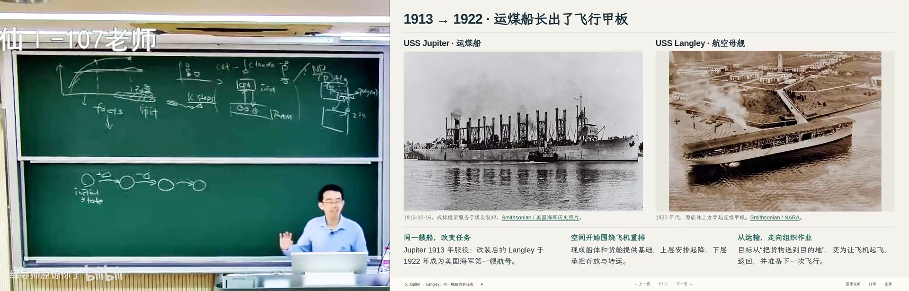
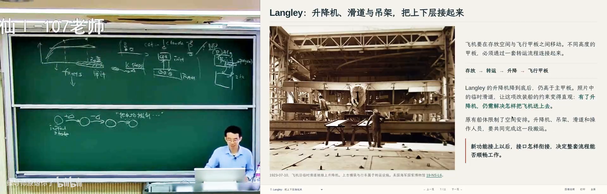
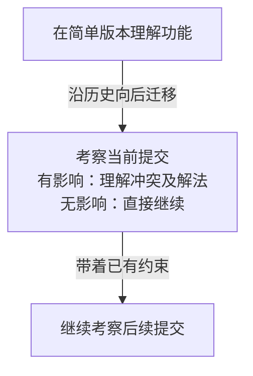
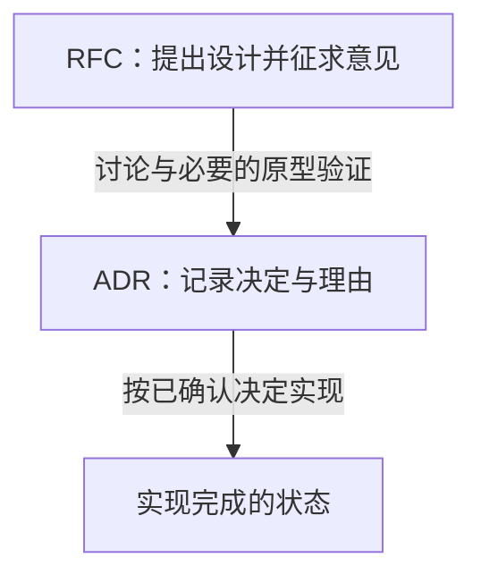
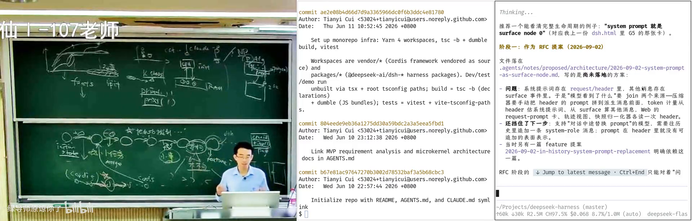
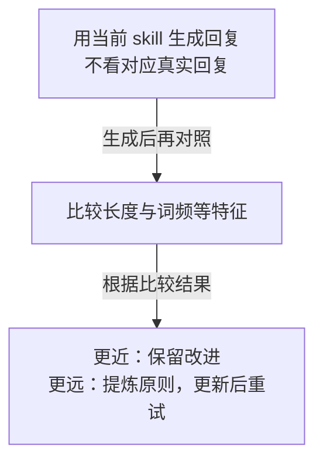

# 软件的演化：航母是怎么造出来的

> 南京大学《生成式软件工程》2026 · 第 10 讲  
> 讲师：蒋炎岩 · 视频发布账号：绿导师原谅你了  
> [原视频](https://www.bilibili.com/video/BV1Guxu6EERa/) · 时长约 100 分钟 · [课程讲义](https://jyywiki.cn/GSE/2026/lect10.md)

上一讲从 DeepSeek Harness（承载模型、工具与插件的智能体运行系统）的代码结构理解架构。这一讲把时间轴展开：复杂系统最初怎样起步，哪些小修改逐渐积累成今天的形态，哪些时刻需要重新设计，以及生成代码变快之后，人还需要作出什么判断。

## 一、我们熟悉的抽象，覆盖了多少真实世界

### 从计算复杂性新闻说起

*(参考时间: 00:00:24–00:06:27)*

课堂开场提到，OpenAI 声称找到了否定 ETH（指数时间假说，对某些计算问题所需时间下界的一种猜想）的算法。讲师强调，这与找到多项式时间算法仍有区别。编者核对的[发布公告](https://openai.com/index/building-scientific-understanding-with-academic-communities/)也把相关文稿视为仍需学术共同体理解的研究材料；这里保留发布方声称与独立检验之间的距离。

这引出一个更基础的问题：为什么理论计算机科学用 P（可在多项式时间内求解的问题类）描述高效计算？NP（候选答案可在多项式时间内验证的问题类）中的 N 来自 nondeterministic，即非确定性，并非“不是 P”。这些是帮助理解课堂讨论的基础释义。按课堂所强调的区别，否定 ETH 不能直接理解成已经证明 P 等于 NP。

把运行时间为 n² 和 n¹⁰⁰ 的算法放在同一类，对实际运行来说非常粗糙。后者即使输入规模不大，也可能根本跑不出来。多项式时间之所以方便，有一个重要的结构理由：多项式时间的程序在执行过程中，只能产生多项式长度的输入；调用另一个多项式时间程序以后，整体仍在多项式时间内。这种对程序复合的封闭性，让我们可以组合已有算法，也使理论推导更容易组织。

讲师认为，这种抽象也反映了人类的理解能力有限。我们真正关心的，可以是更细的问题：给定一台形式化的计算机、一个明确的问题和 k 步执行机会，究竟能完成什么？在 RAM 模型（把内存访问等操作按给定代价计算的抽象计算机）中，指令、数据排布和压缩方式都可能改变有限步数内能做的事；只看“是否为多项式”，许多差异就被抹平了。近似线性时间的网络流算法之所以令人惊讶，也提醒我们：熟悉的分类没有穷尽问题内部的结构。

### 分类、对称与智能：一组思想实验

*(参考时间: 00:06:27–00:08:56)*

生物分类提供了类似的例子。猫和狗很容易区分，但观察更微观的生命与谱系关系时，整齐的树状分类可能不够；关系甚至需要用图来表达。讲师明确说自己并非这方面专家，借此讨论的是人类偏爱干净模型的倾向。

他进一步提出一种猜想：也许真实世界的结构远比我们习惯的理论复杂，我们只是恰好处在一个相对“平坦”、规律可以复用的区域。规律可以被压缩成经验，经验又能帮助预测与行动，于是智能才有形成的机会。课堂还借对称性与守恒量展开联想。这里应保留为关于理解、压缩和智能的思想实验，不能读成已经证明的物理学或智能理论。

## 二、用学习的过程展示自己的能力

### 从一份作品，追到产生作品的轨迹

*(参考时间: 00:08:56–00:13:38)*

过去常见的教育循环是：家庭投入教育，大学培养人才，企业购买劳动。讲师担心，当有经验的人借助智能体就能完成更多工作，企业可能更不愿承担培养新人的成本。这是他对就业变化的判断，并非对所有企业招聘行为的统计结论。

他的建议是保存 AI trajectory（人与模型协作时留下的问题、反馈、操作和产出轨迹）。轨迹可以去掉冗长的工具调用输出，保留有意义的图片、代码等产物，整理成个人时间轴。真正值得看的包括：你提出了什么问题，模型给了什么回答，哪些想法来自你，你如何纠正回答，以及最后的代码是否能运行。

轨迹还给面试提供了新的切入点。用人单位可以随机挑一天的讨论，追问当时为什么这样判断、今天又会怎样看待。讲师认为，过程记录加上随机追问，比只看精修后的成品更难临时伪造。这是关于评估方式的设想，不意味着日志天然真实，也不意味着拥有日志就能准确预测一个人的未来。

同样的入学分数，可能对应完全不同的成长曲线。有人此后很少继续学习，有人不断发现更好的协作方法，把经验沉淀成 skill（可复用的一组操作方法与约定），下一次处理同类问题就发生改变。轨迹的价值，正在于展示这些变化，而不只是累积做过多少件事。

### 优势、隐私和新一轮竞争

*(参考时间: 00:13:38–00:19:34)*

轨迹越完整，对人的刻画也越深入。它可能暴露兴趣、判断习惯、生活安排和尚未成形的想法。讲师用“出卖灵魂”的强烈比喻，表达获得协作优势与交出隐私之间的矛盾：一方面，模型持续提供帮助与正反馈；另一方面，服务提供方也掌握越来越多关于使用者的信息。

他还设想，让双方的智能体先比较轨迹，找到观点一致与分歧之处，再由人继续讨论；甚至把这种方法用来匹配朋友或伴侣。这些是带有玩笑成分的产品设想。模型帮助补充知识、寻找论文和检查想法的作用，与模型能够完整理解人格，是不同强度的判断。

把轨迹投射成简历或个人网站，可能带来阶段性优势。但讲师也提醒，一旦大家都这么做，就会出现新的内卷和 reward hacking（迎合评价指标而偏离原本目标）。保存过程不自动等于真诚学习；竞争也可能反过来塑造记录的内容。

“上学是期货投资”指的是今天投入青春、学费与放弃的工作收入，押注几年后技能仍有市场。他顺着这个比喻提出“贷款上班、先交保证金证明能超过 AI”的尖锐设想，追问技能贬值和再训练成本由谁承担；又设想过类似限制能力继续增长的协议。这些是课堂的预测与反问，不能作为已经存在的就业制度来理解。

## 三、平台的未来，长在它的使用方式里

*(参考时间: 00:19:34–00:23:36)*

DeepSeek Harness 延续了“一切皆插件”的思路。可以把它类比成操作系统：操作系统通过进程、文件和句柄等接口让程序组织能力；Harness 则通过事件总线（让不同组件发布和接收事件的通道）及插件约定，连接智能体、模型上下文与各类能力。具体功能逐渐由这个共同基础承载。

讲师把它比作一艘刚能起降飞机的航母：平台已经搭起，上面究竟会长出哪些“飞机”，还在试验。最终成功的平台未必就是今天的 DeepSeek Harness，但围绕智能体形成的生态值得期待。课堂提到可能出现移动端连接常开个人电脑的用法，让任务继续在自己的电脑后台执行；这是当时的产品消息与使用设想，本书没有把它当作已完成的实际测试。

“实时简历”也是一种插件设想。监听人与插件、插件与上下文的交互，保留合适的模型调用记录，就可能把轨迹投射成不断更新的个人页面。GitHub 的贡献墙是容易理解的参照：颜色反映提交活动，但提交次数可以被机器放大，因此活动量也不能直接代表个人能力。

UNIX 的创建者不会预先知道几十年后的全部组合方式。原来用于翻页阅读的管道，也能接入新的语言模型工具。一个平台能否持续生长，要在后来的人如何组合它、如何引入新能力中观察。提前断言哪个产品会胜出，超出了课堂论证能支持的范围。

## 四、把航母的时间轴展开

### 最终成品里，藏着长期积累的知识

*(参考时间: 00:23:36–00:27:51)*

2019 年，讲师在圣迭戈参观 USS Midway（中途岛号）博物馆。管线、蒸汽、电力、通信和损管系统交织在一起，让他惊讶于人如何能构建如此复杂的机器。战争环境又要求系统在局部受损后仍有可执行的应对办法。

他回忆，一位曾在舰上服役的志愿者解释，操作人员不必重新推导整舰设计，而是通过操作手册知道某种故障出现时应处理哪个阀门、采取什么动作。设计者的推演被转化成流程，由不同岗位的人共同执行。复杂系统的能力因此同时存在于设备、接口和人的工作方法中。

真正给他启发的是展示历代航母的陈列：如果只看成品，复杂性像是凭空出现；追到早期状态，再逐步看变化，就能理解知识怎样积累。课堂对 Midway 服役年代的个别回忆不够精确，本书取其工程论证，不据口述重建舰史年表。

### 从远航帆船，到把机场搬上船

*(参考时间: 00:27:51–00:35:44)*

课堂先看 Santa María（圣玛丽亚号）帆船：1492 年，它成为哥伦布首次航行的旗舰。帆、索具和机械配合虽已复杂，仍容易让人追索各部分的作用。随后看到 1811 年的 New Orleans（新奥尔良号）汽船，以及它在 1812 年抵达新奥尔良的故事。早期汽船以外露的明轮推进，与今天隐藏在水下的螺旋桨有明显差别。

变化通常来自小的增量：发现某个结构有效就加入，发现不再需要就移除。有时旧技术和新技术还会并存。桨与帆曾共同使用，后来远航条件改变，某些部件退出；“轮船”这个名称却可能在推进方式变化后继续保留。

USS Langley（兰利号）的例子把这种变化推到新的用途：一艘运煤船已有承载重量的能力，如果把上层改成木质飞行甲板，能否把机场搬到海上？一个短句提出了新目标，随后却要解决一连串具体问题：跑道多大，飞机存在哪里，有限的船体空间如何安排，怎样把飞机从下层送到甲板。

升降机连接机库与甲板，但飞机能否及时被送上来，又影响起飞效率。课堂画面还展示一个具体接口问题：兰利号的升降机降到底后仍高于主甲板，飞机需要经临时滑道、吊架与人员配合转运。于是，新功能牵动空间、运输设备与操作流程，不能靠“加一块甲板”就宣布完成。到更复杂的航母，系统之间的配合也越来越密集。

这种演化同时包含不同尺度的工作。把运输船改成起降平台，是显著的架构变化；调整管线位置、避免高温蒸汽影响邻近设备，则可能只是局部修正。小修改与大变更共同塑造成品。课堂把这些船放在一起，是为了理解能力如何积累，并非断言它们组成一条直接的船型继承谱系。

### 生成式开发改变了试验的步幅

*(参考时间: 00:35:44–00:40:51)*

讲师也用“造航母”形容自己的平台探索。在传统工程中，试一个想法常要付出很高实现成本；如今可以先借助模型做 MVP（用来验证关键想法的最小可行产品），观察效果，再回到早期状态把结构与细节重新做好。原型允许跨较大的步幅，后续仍需要严格的整理和验证。

这也带来新问题。模型第一次搭出的架构可能很漂亮，随着需求和本质复杂性增加，却越来越难修改。早期成功的软件往往从一个解决真实问题的简单想法出发；能跑通原型，尚不足以证明最初架构适合长期维护。讲师借此把人的顿悟、知识积累与系统演化联系起来：今天的状态，需要放回它形成的过程理解。

## 五、学习复杂系统，可以先回到自己看得懂的版本

### 简单版本保留了理解的入口

*(参考时间: 00:40:51–00:45:02)*

Python 2 的 `print` 可以作为语句使用，Python 3 则把它变成函数。一个早期设计后来会与整套语言和生态发生联系，修改也就不再只是改一个语法点。讲师同时说，课件里调度器、Python 和 Kubernetes 等例子，并没有完全表达他在航母故事中感受到的演化过程；阅读时应保留这份判断，不把课件上的每个点都扩写成课堂已经充分论证的案例。

对初学者来说，直接面对今天的 Linux 容易只看到无穷的复杂性。Linux 0.11、较早的 2.6，或教学系统 xv6（为了学习而精简的类 UNIX 操作系统），提供了较容易掌握的起点。编译器、数据库也可以从类似的简化实现入手。当前学习模型系统时，nanoGPT、nano-vLLM 这样的精简项目，同样承担了理解核心机制的作用。

讲师自己在 Linux 2.6 时期进入这一领域，后来仍会问：如果放在那个较简单的模型中，这件事应该怎样实现？先在可理解的系统里想清楚，再追踪是什么让今天的做法发生变化，就有了进入复杂系统的路径。

### 把一个功能沿历史向后迁移

*(参考时间: 00:45:02–00:50:36)*

课堂以获取系统信息为例：应用想知道时间、所在 CPU 等信息，是否每次都必须进入操作系统？可以设想一页由内核与应用共享的数据，内核更新，应用只读。先在简单系统中思考它的权限、更新与读取，再看后来的机制会怎样影响它。这是用于理解的简化例子，不能据此断言现代内核仅按课堂几句话实现全部细节。

接下来可以在思维中做一次 git rebase（把一组修改迁移到另一段版本历史之上）。假设早期版本加入了这个功能，再沿着提交历史向后走：新的调度算法是否影响它？新机制是否与它冲突？如果无关，就继续；遇到真正冲突，才仔细研究当时为何这样解决。

图注：依据 00:45:02–00:49:42 整理。箭头表示学习时的考察顺序；这是理解历史的方法，不要求实际重放所有提交。

这种方法依赖系统对复杂性的分解：一个功能通常只与少数部分紧密交互。如果每次变化都牵动所有地方，维护本身就难以持续。因此，重点是找出少数关键交互，理解简单模型在什么地方失效。

讲师认为，Git 历史保存了人类创造软件的过程，是值得研究的资料。他进一步设想，把数学或其他工程的发现、分支和重新组合也整理成可追索的历史。这个愿景尚不是课堂交付的知识系统。对学生更直接的启发是：无论做操作系统、编译器、数据库，还是在 nanoGPT、nano-vLLM 上尝试多卡或小设备推理，都可以同时追问功能的来源和演化。

## 六、小任务评测为什么有分量

*(参考时间: 00:50:36–00:57:50)*

如果演化由一系列提交组成，而多数提交是修 bug 或小功能，那么模型能否把“一件小事”做好，就成为关键问题。SWE-bench（让模型在真实仓库中解决 GitHub 问题的评测集）把现有代码、问题描述、修复与测试联系起来。它考察的是进入已有项目完成一次修改，而非只生成一段孤立程序。

课堂回看早期论文时，展示了低个位数的解决率，并指出当时的模型输入与今天能调用工具反复执行的工作流还有差别。讲师据此强调这项评测的远见：如果软件演化中大量琐碎任务都能自动完成，工程工作的分工就会改变。他关于初级工种受到冲击的强烈表达，是从这种任务结构推导出的判断，不是评测本身已经证明的就业结论。

这种评测也有局限。测试只给出一组可执行的反馈，不能代表所有工程价值。有的 bug 持续出现，是因为两个模块在早期没有分清职责；人可能会重构整个模块，让这类问题消失，而不是继续修补局部。但在一个既定 issue（项目中记录的待解决问题）任务里，局部补丁往往更容易被明确判定对错。

课堂还提到 SWE-bench 的不同后续版本以及 Terminal-Bench（考察终端环境任务的评测）。这些名称说明评测在扩展，不能把不同数据集、模型和运行设置的成绩混为一个通用能力数字。本书保留课堂关于早期低解决率的结论，未把它当作今天排行榜的现状，也未替课堂中辨读不清的小数补造精确值。

## 七、架构取舍需要更丰富的反馈

*(参考时间: 00:56:12–01:04:33)*

什么没有被小任务评测充分覆盖？首先是项目的起点：决定要造什么，建立仓库，放下初始计划。其次是演化中的大事：什么时候应停止补丁式修改，重构哪个子系统，要采用怎样的新结构。

架构存在于不同尺度。顶层架构约束系统整体，子系统内部也有自己的边界，甚至一个函数采用何种组织方式，也体现局部设计。课堂以 Bun（执行 JavaScript 等程序的运行时）从 Zig 向 Rust 的迁移说明大范围改变带来的惊讶，并提醒：能否迁移与项目结构有关，不能从一个案例推及任意大型数据库。本书没有把课堂的惊讶解释成“迁移绝无缺陷”；[发布方后来的说明](https://claude.com/resources/articles/ai-code-migration)也记录了合并后的回归问题。

重大变化既少，又不一定存在唯一最佳答案。它们的反馈比大量日常修复稀疏。讲师因此关心 few-shot learning（从极少案例中获得可迁移能力）：模型能否像人从一个案例中顿悟那样，改变自己理解问题的方法？课堂提到内核子系统重构，也是在追问为何当时必须改变、为什么那条路线可行，而非给出适用于所有项目的重构时间表。

他把需要的评测暂称为 taste bench（评估设计判断和取舍能力的基准设想）。小任务常可由测试给出通过与否；架构决策则可能同时面对性能、工期、改动范围、迁移成本和风险。换成事件溯源（把发生过的事件保存下来，再据此恢复状态的设计方式）也许能解决某些问题，却增加迁移规模；更保守的改法也许降低一次改动的风险，却拉长达到目标所需的时间。

这些选择需要多维比较。把一切压成总分，会像只看考试总分而看不到各科能力一样，遮住项目真正需要的能力组合。讲师还提醒，围绕评测进行训练与策略调整，会影响分数的意义；得到更高分，需要继续追问究竟学会了什么。taste bench 在本讲中是一项研究方向，尚不是已经建立并验证的标准。

## 八、在 DeepSeek Harness 的历史里寻找设计理由

### 从提交时间轴看到关键转折

*(参考时间: 01:04:33–01:11:33)*

DeepSeek Harness 公开的提交历史，让课堂可以把“航母怎么长成”落到真实项目。讲师展示从 2026 年 6 月 10 日初始提交开始的早期历史，并让模型总结其中的重要机制与决策。模型沿用航母比喻作出的解释，不全是他想要的结果；他也提醒，摘要仍可能漏掉有趣的变化。

早期一个关键动作是引入 Cordis（管理插件、服务及其生命周期的框架）。课堂说，它起源于作者管理 QQ 机器人插件时对加载、卸载问题的整理；DeepSeek Harness 并非从零发明所有能力，而是把已有框架带进来，再逐步实现模型推理与智能体循环。这个故事本身又有一条更早的演化历史。

课堂展示的总结，还把可回放的会话记录、循环与适配器的分离、进程和文件等资源抽象，以及超时、取消、输出溢出等约束，视为让系统从“能跑”走向真实机器可用的工作。这里记录的是课堂对历史的阅读，未逐个检验整仓的提交结论。

另一个被强调的转折是从终端界面走向浏览器。浏览器及 DOM 树（网页元素组成的结构）使界面扩展有了不同基础。关键不只是多了一个界面，而是平台能承载怎样的扩展随之变化。哪些阶段和日期值得关注，应继续沿具体提交核对，不能把模型生成的时间轴当作没有遗漏的史实。

### 把提案、决策和实现状态分清

*(参考时间: 01:11:33–01:16:08)*

RFC（请求讨论、尚可修改的设计提案）让团队在改代码前，把重要选择摊开。它承认提案可能有错，也让其他成员补充意见。团队可以先在共享文档中评论，必要时开会，还可以在独立分支上试一个原型，再决定正式方案。

讨论收敛后，ADR（记录已经作出的架构决策及其理由的文档）保存为何选择这条路线。随后才进入实现完成等状态。把提案、决策、实现分开，能让后来者看出一个想法究竟处在什么阶段。

图注：依据 01:11:33–01:16:08 整理。箭头表示课堂介绍的推进关系；原型验证按需要进行，不是每份提案的强制步骤。

课堂给出的具体问题是 system prompt（规定模型角色与行为的系统消息）与其他消息的存储不统一：前者放在请求头，其他消息进入会话事件。新增“对话中途替换系统消息”的需求后，原有表示就难以容纳，需要讨论是否改成统一抽象，并记录决策后再实现。一个看起来只涉及消息的小改动，对上下文管理子系统已经是重要设计变化。

### 协作方式也会随规模改变

*(参考时间: 01:16:08–01:17:49)*

讲师展示当时约 2.2 万次提交，并联系自己小团队采用线性历史的经验：没有合并节点时，每个变化较容易单独追踪。但若外部开发者增多，主线每次前进都要求各分支重新迁移，再触发持续集成（CI，提交后自动运行的一组检查），成本就会上升。

这里没有一种永远正确的协作模型。团队规模、贡献来源和验证成本改变后，工作方法也需要演化。课堂同时提到逐文件覆盖要求、真实产品与发布产物的验收层次；这些层次回答不同问题，不能只凭某一项覆盖率就认定产品完整可靠。

## 九、把已知错误变成能够执行的约束

### 检查规则的收益，也有维护代价

*(参考时间: 01:17:49–01:22:42)*

严密的流程仍不能保证模型生成的所有内容都合适。讲师观察到，模型有时不断追问，有时自行猜测，还有时在实验性工作中加入过量测试和文档，使后续修改更复杂。最终仍需要人把握项目的目标和轻重。

国际化文档就是一个具体取舍。i18n（让产品支持多种语言的工作）要求中英文 README 同步。用额外的 YAML（以文本保存结构化数据的格式）文件记录对应关系，能帮助检查不一致，却增加仓库里的文件与关联负担。讲师认为，目录和文件未必是保存全部项目关系的理想方式；眼前方案仍可能只是权宜之计。

文档本身也会制造这种负担。模型把“做了 A、做了 B、不要 C”等实现过程都写进文档后，这些陈述就与代码形成同步修改关系。实现迭代时，A、B 可能已经删除，一条过时的“不要 C”却留下来。文字越多，需要维持一致的关系也越多。课堂查看的写作规范因此要求去掉推理过程、重复和无用修饰，把读者真正需要的内容留下。

### 从经验中逐项建立检查

*(参考时间: 01:20:00–01:30:50)*

课堂总结的办法是：遇到一种已知坏特征，就尽可能写成可执行的验证规则，在提交、推送或持续集成中阻止它进入项目。这是随着经验不断补充的防线，不能穷尽所有坏设计。

| 检查对象 | 课堂中的具体问题与作用 |
|---|---|
| 代码 | 统一 lint（自动检查代码规范和常见问题的工具）与类型规则；接口改变后，调用方也必须跟着改；不同用途的字符串 ID 不应随意混用。 |
| 异步 | 检查未处理的 Promise（代表异步操作结果的对象）、未回收资源、危险断言、废弃接口及未使用变量。未使用变量可能暴露变量名写错等低级错误。 |
| 架构 | 检查浏览器代码是否误依赖宿主实现、客户端依赖是否越界、控制流是否经过规定的插件机制。功能运行成功，也可能仍破坏结构。 |
| 数据 | 持久化与兼容性检查约束保存下来的数据、运行时边界及后续变化必须遵循的合同；课堂列出这一检查类别，未逐条展开其全部实现。 |
| 文档 | 检查文档导出说明、硬编码界面文案以及中英文配对关系，减少代码与说明脱节。 |
| 交付 | 构建和类型检查之外，还要分别确认真实产品及发布产物；自动检查与评审共同进入工作流程。 |

有些严格规则与项目阶段有关。个人试验可以暂时使用某些不安全能力；正式项目如果规定某个包禁止 Rust 的 `unsafe`（允许程序员承担部分安全证明责任的代码区域），就可以把约定变成工具检查。试验版本先验证想法，进入正式版本前再满足约束。

规则还要安排到合适的时机。pre-commit（生成提交前的本地检查）可以验证文档配对等约定；pre-push（推送前的检查）可以运行类型检查；CI 再执行适合集中运行的更多验证。这里描述的是课堂查看的分层方法，不要求每个项目机械复制全部规则。

一个典型失误是：模型实现新功能时，另写一套逻辑，再在核心代码中直接加一行函数调用。功能可能已经可用，却绕开“一切皆插件”的约定。团队既可以把规则写进说明，也可以检查控制流是否由插件发起。前者占用上下文、增加阅读负担；后者需要把经验转成可判定的约束。网络调用是否绕过用户代理、浏览器请求怎样解析地址、第三方代码如何更新，也有类似的项目特定边界。

对学习者来说，可迁移的方法是：选一个自己确实需要的项目，整理它的提交时间轴，再查看文档质量、依赖边界和发布验证如何演化。具体规则会随语言和业务改变，追问规则为什么出现，才有助于理解项目。

## 十、反例反馈之后，还要寻找更一般的原则

### 一条条禁止，为什么会让上下文膨胀

*(参考时间: 01:30:50–01:36:49)*

模型有时过分自信，有时过度谨慎；用户一纠正，它又可能把“不要这样”分别写进文档和代码注释。上下文不断膨胀后，局部禁令会抢占注意力。讲师用番茄炒蛋举例：“不要放蒜”可能只是在修正一次错误，模型却未必理解同样无关的香菜、韭菜和蘑菇也不需要出现。

程序合成（根据规格或例子自动寻找满足要求的程序）早已遇到类似问题。Excel 智能填充的经典例子，是用少量输入输出示范，把不同写法的电话号码统一拆成区号和号码。Programming by Examples（从输入输出例子推断程序）与 Programming by Demonstration（从操作示范推断程序）提供了不同表达意图的方式。讲师认为今天的大模型已使这类任务容易许多；这仍是对能力趋势的课堂判断。

CEGIS（用反例不断约束候选程序的合成方法）提供了另一种联系：先给规格，生成一个候选，再用不满足预期的例子反馈，推动下一轮修改。困难是，有限样本可能对应很多程序。再给一个例子，模型也可能只加一条特殊判断，碰巧覆盖该输入，却没有获得你真正想要的规律。

写作的去套话规则也有这种倾向。发现反复使用某些词、过重的宣传口吻或“not just X but Y”句式，就逐条禁止；但新变体仍会出现。课堂列出的 ensuring、highlighting、showcase 等表达，意在观察模型的固定偏好，并非宣布这些英文词在所有学术写作中都不应使用。更难的任务，是从反例抽出一个能覆盖更多情形、又符合作者意图的原则。

## 十一、怎样判断一个 skill 是否真的在进步

*(参考时间: 01:36:49–01:39:53)*

讲师用自动回复邮件说明这个问题。他发现，即使把自己过去回复的邮件放进上下文，模型也未必能写出符合自己习惯的长回复。单纯提供很多样本，还不足以保证模型提炼出所需的风格。

他的尝试是构建递归改进循环：让一个写邮件的 skill 面对过去的来信生成回复，生成时不看对应的真实回复；再以真实回复作为对照，检查回复长度、词频、句长和标点使用等指标，观察候选是否更接近目标。如果更近就保留；如果更远，就要求从失败中提炼一条更一般的指导原则，放回 skill，再试下一轮。

图注：依据 01:37:06–01:39:53 整理。箭头表示课堂描述的条件反馈；统计特征只覆盖风格的一部分，不能单独证明文字质量全面提高。

这里想得到的，是能解释多种反例的原则。例如，一次“不要放蒜”背后，可能需要约束的是加入无关内容；但究竟应归纳出什么，仍必须回到任务和更多实例检验。讲师明确说，今天这件事还做不到他期望的程度，同时对今后的改进保持乐观。

这一结尾又回到软件的时间轴：日常小修改已有清楚的反馈，大方向的改变则需要更丰富的判断与证据。能否建立一个持续改进的循环，让系统在做好小事的同时学会处理大事，是本讲留下的问题。

---

来源说明：正文以本讲完整可用字幕为主，结合课程主页及明确列出的官方材料校正专名。平台字幕存在少量无覆盖区间和识别错误；存疑的小数、个别舰史回忆及未充分展开的架构例子保留边界。课堂截图对应所标时间，概念图为依据相邻讲述整理。课程讲义标注 [CC BY-NC 4.0](https://creativecommons.org/licenses/by-nc/4.0/)，原课程与讲义归属保留。
