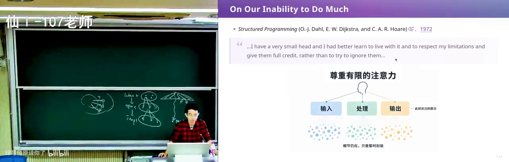
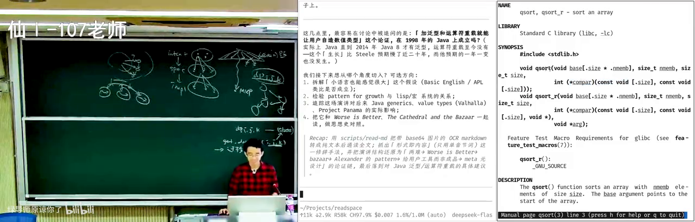
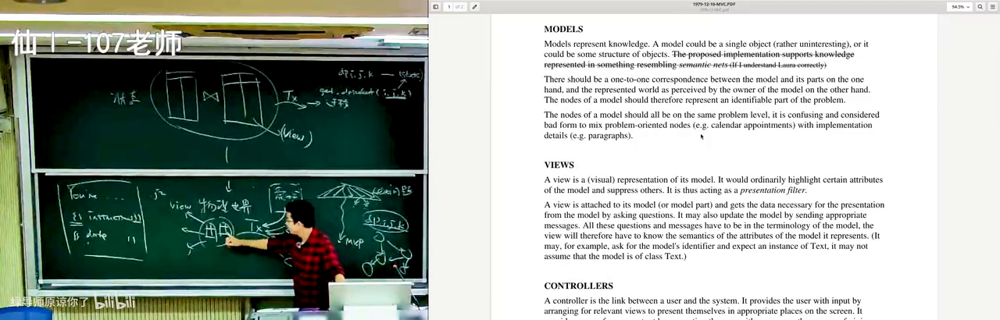
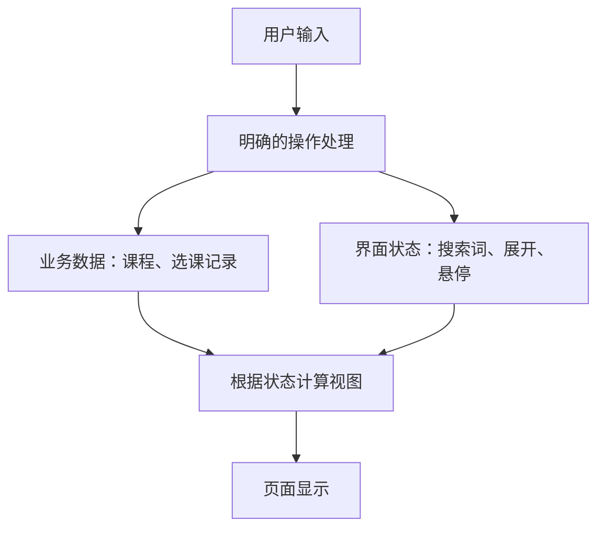
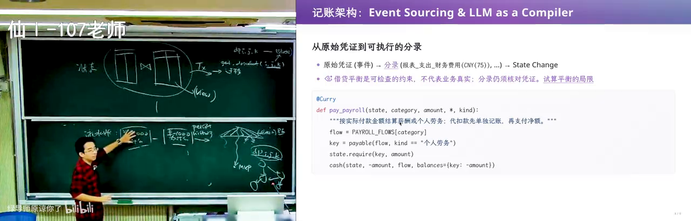
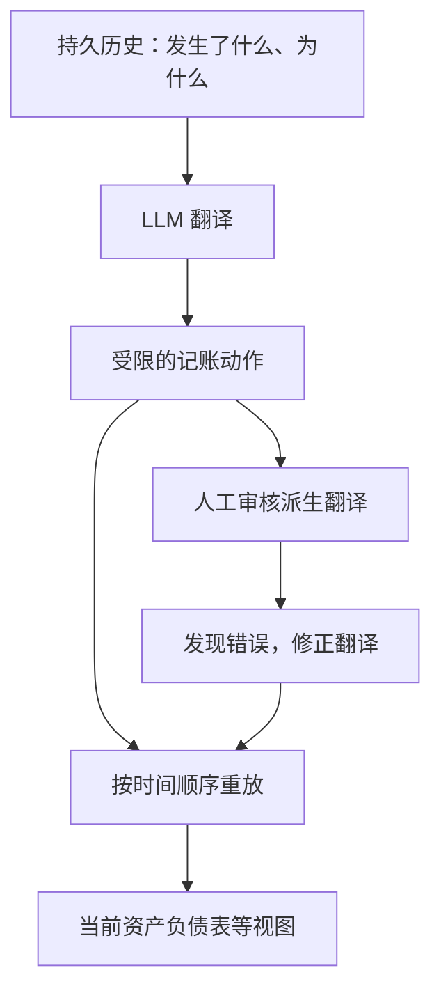
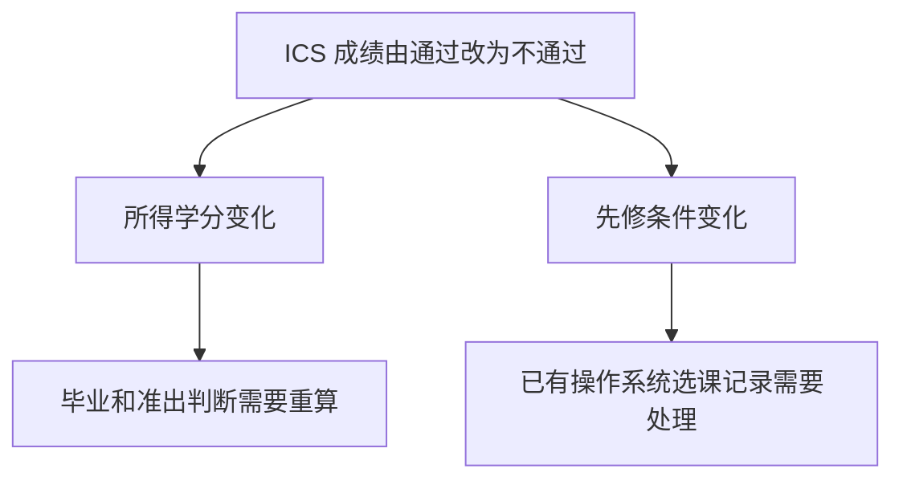

# 需求和架构（二）：让系统容纳变化

课程：NJU · 26 生成式软件工程 · 第 7 讲  
讲师：蒋炎岩（绿导师原谅你了）  
原视频：[需求和架构 (2)](https://www.bilibili.com/video/BV1JGap6LE74/)  
时长：约 1 小时 39 分 41 秒

> 本书依本讲字幕整理，保留关键论证、案例与条件。专名结合官方课件和一手资料核对；未听清或未证实之处就地注明。图中的流程为根据课堂说明重绘的示意，不是新增实验结果。

## 1. 满足需求之后，为什么仍会陷入维护泥潭？

*(参考时间: 00:00:01–00:14:16)*

### 两类复杂性与每次选择的代价

本讲接着上一讲讨论需求与架构。上一讲用浏览器操作逆向整理的是教务系统中**与教师有关的需求**，并非整个教务系统。得到一份需求规格说明书后，仍然没有唯一的实现方案：同一个意图可以有不同的规格，同一份规格又能用不同的数据库、模块和代码实现。这里的规格，是对软件应做什么、应满足什么条件的明确约定。讲师提醒，代码之外还有客户的规律，客户之外还有社会的规律，社会之外还有物理世界的规律；站在哪一层看需求，会改变对方案的判断。

讲师提醒：即使软件百分之百满足客户当前的要求，也可能在未来维护中陷入泥潭。原因在于，每个设计决定都会改变以后可走的路。这就是技术债（当前选择给未来修改和维护留下的成本）；从十行小函数到百万行系统，都可能承担这种成本。因此，“AI 已经把它做出来了”只是一个起点。第一反应想到一种数据库设计时，还应回头比较：有没有别的组织方式，能让下次变化更容易承受？

软件工程要驾驭的复杂性并不全来自代码。**本质复杂性（essential complexity：问题本身固有、不能靠换工具消除的复杂性）**，在选课系统里就是课程容量、先修要求、时间冲突、排课、教室条件以及师生借用教室之间的约束。物理世界本来如此，投射到信息系统里，这些关系依然存在。

架构不能把这些事实变没。它能做的是安排谁负责哪部分规则、规则之间怎样协作，使人不必同时盯住所有细节。否则，即使换一种语言或让模型重写全部代码，也只是把同一个复杂问题搬到了另一个实现里。

另一类是**附带复杂性（accidental complexity：由所选技术和实现方式额外引入的复杂性）**。用文件管理数据很直观，开发者容易查看、修改，也能组合 UNIX 工具；代价是要面对性能、并发，以及多次读写如何作为一个整体完成的问题。事务（把一组操作当作整体处理的机制）所追求的“全部完成或全部不发生”，不是随意拼接几个文件读写就能自动获得的保证。

改用数据库，可以把事务等责任交给数据库，但看数据、调试数据又多了一层查询和转换。讲师随即补充，数据库查询结果当然也能和其他工具组合，只是多了接口层。这里并没有“文件好、数据库坏”的结论；两种方案都改变了取舍空间，应比较它们引入的成本与所隔离的复杂性。

### 登录功能怎样长出一棵决策树

*(参考时间: 00:05:35–00:10:45)*

需求工程直接面对“到底要什么”。课堂推荐尝试 Matt Pocock 的 **grill-me（用连续追问澄清设计选择的 Agent 技能）**。以购物车登录为例，若只告诉 GPT“我要登录”，模型可能自行选择用户名和密码，于是问题立即展开：要不要注册？密码要不要输两遍确认？忘记密码怎么办？通过短信还是邮件找回？谁来提供发送服务？

接第三方认证又是另一条分支。讲师用微信、支付宝举例，指出便利之外还有费用、个人开发者和公司主体条件等现实约束；这些是课堂当时的说法，并不是本书对当前平台政策的核验。这个例子要说明的是：选择认证方式尚处在需求层面，却已决定很多后续工作。没有被问出来的选择并不会消失，只会变成模型替你做的隐含决定。

讲师将需求探索分成两种互补方向。深度优先做 **MVP（最小可行产品：先让核心功能走通的可用切片）**，尽早判断重要功能是否成立，也让第一轮、第二轮推倒重做发生得更早。广度优先则横向比较登录方式、首页布局等不同选择，先看清可选方案与各自代价。

两者不冲突：只向深处走，容易过早锁死一种设计；只列选项而不做东西，又缺乏验证。即使 AI 可以从代码逆向出长长的需求列表，读者仍需看懂背后的设计哲学，才能判断哪些选择服务于产品目标。自建、交给第三方、尽量简化，都要结合目标比较。讲师关于偷密码的调侃明确属于不合规反例，不能理解为产品建议；真正能积累经验的，是动手尝试并对照不同设计。

### 用契约隔离责任，给未来保留选择

*(参考时间: 00:10:50–00:14:16)*

架构的一项基本工作，是以模块和接口隔离复杂性。接口契约（使用方与实现方约定的能力和条件）让上层只依赖必要承诺，而不必接管下层全部细节。例如，数据库负责存储、备份、可靠性与事务后，业务开发者就能把注意力放在业务规则上。

课堂以云数据库的备份、可用性承诺说明这种分工。应理解为“选定服务后依其契约协作”，而不是任何云服务都绝不会丢数据。把责任放到边界另一侧，前提恰恰是弄清楚对方承诺了什么。

校园系统暴露了另一种张力：用户希望信息只填一次，各系统能共享数据、互相通知；实际中连统一身份都可能推进很久，财务系统更难完全打通。讲师用平账、审计等独立领域知识解释原因。不同模块不是换一套界面的同一种业务，领域责任需要隔离，同时又必须设计跨边界的数据交换。这比一句“把系统全部打通”具体得多。

可以把需求和架构看成连续收缩选择空间的过程。需求澄清意图，减少“客户到底想要什么”的不确定性；架构进一步约束规格与实现的选择，防止系统随每次开发任意漂移。但每固定一种选择，也放弃了某些未来路径，并留下相应技术债。

因而，架构要回答的不只是今天选哪个解，还包括哪些事应统一、哪些变化应留给以后。接下来的经典、语言和系统案例，都是从不同尺度回答这个问题。

## 2. 用有限的头脑理解复杂程序

*(参考时间: 00:14:17–00:33:37)*

### 经典值得读，全文仍要读

讲师打开 1972 年的《Structured Programming》（《结构化程序设计》，Dahl、Dijkstra、Hoare 合著）。书中的示例往往很小，讨论顺序、选择、循环，以及是否需要 **goto（让程序跳到指定位置继续执行的语句）**。只看这些例子的规模，很容易误以为它与现代大系统无关。

但小程序已经需要组织结构：怎样把逻辑拆到人能理解的粒度，怎样组合局部推理，让整体仍然可理解。现代系统规模变了，这个困难没有消失。讲师希望读者从这些早期争论中寻找设计思想，而不是因为代码旧、小，就跳过原文。

讲师介绍了自己的 AI 辅助阅读实践。他认为操作系统、编程语言与软件工程在 1980—2010 年间有许多值得读的经典，称之为自己关注领域的“黄金期”，并认为后来不少研究方向越做越窄；这是他的研究观察。他让背后有云电脑的 bot 搜集约一千篇文献，各领域大约两三百篇，再凭自己读过其中大部分文献的经验，逐项核对推荐列表。字幕把 bot 名称写作“grog bot / group bot”，具体产品名未确认，不能据此认定为 Grok。

这里的重要步骤不只是得到摘要或推荐单：论文全文被提供给 AI 或纳入可访问的索引，接着从自己已知的知识出发追问——它解决了什么以前不知道的问题，采用什么手段，得到了什么结论，与自己已有知识有什么联系。这样，阅读把一个新节点接入知识网络。推荐质量仍要判断，全文仍是解释和核对的依据。

### 从“small head”到概念层次

*(参考时间: 00:19:36–00:26:56)*

Dijkstra 的“small head”指向架构背后的认知限制：一个人一次只能处理有限的内容。承认限制后，设计目标就不再是让人一眼看懂所有实现，而是让他一次理解一层，并有理由相信其他层的承诺。

课堂沿着原书讨论枚举、归纳和抽象。枚举面对具体情况，归纳建立从局部到一般的推理，抽象则暂时隐藏无关细节，以较少概念表达更大的整体。讲师用珍珠项链说明这种层次：不必同时研究所有细节，也能逐个理解组成部分，再理解它们的连接。层次分解不是为了多画几个框，而是让有限的脑力有办法承担复杂任务。

经典中的类（描述一类数据及其操作的模板）和对象（按类组织的具体实例），与**协程（能保留自身执行进度、暂停后继续的协作执行单元）**，都可以放回“如何组织复杂任务”的背景理解。两段需要合作的工作，各自有自己的进度和记忆，通过约定交流；课堂提到下棋程序和编译器等例子，不必把所有控制都压进一个巨大的主流程。

今天，人们常把协程理解为比线程更轻、切换和维护开销更低的执行方式。讲师提醒，这种性能视角不应盖过早期的组织动机：让独立任务以贴近问题的形式协作，使复杂性有边界。教材脚注中的经典因此值得追溯；AI 可以降低找到、读懂第一手全文的成本，而不只是再给出一段现代定义。

概念也可以分层。课堂转述原书借助前缀机制把概念逐层搭起来，但没有在这里展开其语法。把一份数据和对它允许进行的操作封装在一起，上层就能用这个概念继续构造更大的概念，暂时忘掉内部表示。课程与教室是不同对象，它们各自有属性和操作，但仍需要明确关联；“封装”不意味着关系自动消失。

讲师让 AI 面向本科生解释原书、翻译并略去不必要的细节，目的在于跨越阅读门槛。有效的解释仍应交代每一层新建了什么概念，以及读者因此能暂时不关心什么，才能看见概念层次怎样缩短问题与机器实现之间的距离。

### 调试时取回被数字下标藏掉的状态

*(参考时间: 00:27:02–00:31:33)*

**动态规划（DP：保存状态的计算结果，再按状态间关系推得答案的方法）**为什么常常不好调试？模拟程序通常还能拆成若干对象，分别测试，并把中间状态对应到物理场景；一两百行 DP 转移则可能挤在一起，最终只有一个错误数值，程序甚至不会崩溃。

讲师给出的关键诊断是：你思考时并非只想着 `dp[i][j][k]` 这些下标，而是借助了“状态是什么、可能走到哪些状态”的图。当它们被压成纯数字数组，原本帮助理解的抽象被丢掉了。对于课堂讨论的无后效性模型，状态之间还可用有向无环图理解；一个小小的转移错误就可能沿图传播，却缺少直观线索。

调试时应把这层抽象取回来。用有意义的 State 对象表达状态，列出允许的迁移，把它们打印或可视化，检查每一步是否符合原先的含义。先让程序可理解、可验证，再把正确表示改成等价的高效实现。这里没有否定数组优化，而是把“恢复语义以便调试”和“优化最终表示”分成两个阶段。

事件模拟是另一例。可以把所有流程硬写成状态机（用状态及其迁移描述运行过程的模型），也可以先建立协程及 `hold`、`wait`、`activate`、`simulate` 等操作，使代码表达等待、激活和模拟时间。这样，使用者面对的是领域动作，而不必每次重写底层控制。课堂没有给出一份完整可复现的实现，阅读时应沿原书继续追问这些操作的语义，而不是从几个名字推定已有完整代码。

### 让 AI 建立新旧知识的联系

*(参考时间: 00:31:34–00:33:37)*

讲师还报告了当时使用实时语音工具的体验：简单问题可以即时对答，更复杂的问题则让后台更强的思考模型处理，再继续讨论。他要求 AI 用现代前端举例，得到 React Scheduler / Fiber（React 中组织和调度渲染工作的机制）的类比。这个例子的用途，是把旧文献中的协作、分层思想接到熟悉的技术上；它是课堂演示和讲师体验，不是本书对当前产品能力的测试。

他也区分两种回答基础：没有联网搜索时，模型主要凭预训练知识提出联系；有搜索或自建论文池时，可以查阅更多原文再比较。两者都能启发问题，但要判断某个类比是否成立，仍应回到相应材料，而不能把听起来流畅的联想直接当作历史关系。

## 3. 让语言生长，也让架构生长

*(参考时间: 00:33:42–00:49:19)*

### 一场先创造词汇、再表达思想的演讲

从结构化程序设计转向语言设计，课堂介绍 Guy L. Steele Jr.。他参与设计 Scheme，也参与编写 Java 语言规范。讲师特别推荐其 OOPSLA 1998 演讲《Growing a Language》（让语言生长），因为演讲形式本身就在展示它要论证的设计思想。

Steele 从单音节词开始讲话，想使用复杂词汇，就先用已有词汇定义它。听众因此亲身经历一种困难：没有共同词汇，复杂思想很难表达；建立新词之后，后面的表达才获得新的能力。

这里的 language 同时指自然语言与编程语言。演讲不是先抛出“应当可扩展”的结论，而是让人感到词汇如何一步步生长。讲师赞赏这种创意与堆砌出来的 AI slop（流畅但缺少思想价值的生成内容）之间的差异，同时又猜测 AI 也可能写出可读的纯单音节文章。他并没有据此证明“AI 永远做不到”；保留的是对设计创意的欣赏，而不是一条能力定律。

### 小语言、大语言和可生长语言

*(参考时间: 00:38:26–00:43:16)*

编程语言比自然语言和用户需求小得多，因为每种构造都需要明确、可执行的形式语义（精确定义程序如何运行的规则）。极小语言当然也能表达程序，但能表达不等于容易表达。课堂以 Brainfuck（一种只用少量符号指令表达程序的极小语言）的 Hello World 为例：移动指针、增减数值等操作堆成一长串符号，虽然能执行，却很难阅读。原字幕只写出“brain”，此处结合 00:39:16 的屏幕名称及随后展示的解释器、hello.bf 文件校正。

这个例子说明：当可用词汇过少，使用者必须用很长的低层符号串描述简单意图，复杂性被转嫁给了写程序的人。所以，语言小巧本身不是设计的唯一目标。

讲师认为 C 的 `qsort` 接口设计得很糟糕，并以它作为更贴近日常编程的例子：使用者需要提供比较函数，面对 `const void` 指针、元素个数和每个元素的大小等参数。`qsort` 是通用排序接口，但它无法替调用者理解所有具体类型；底层表示因而暴露在调用处。讲师也提到 C 缺少运算符重载——让自定义类型使用类似内置类型运算符的能力。

小语言少了高层表达工具，使用负担会增加；可如果一开始就设计一个什么功能都包办的大语言，设计与实现又可能太慢，尚未交付就被先出现的小语言占据市场。这里的两难是“表达能力”和“实现、推广成本”之间的架构取舍，不是简单要求功能越多越好。

讲师认为，C 的成功恰与它接近机器、额外抽象少、容易移植有关。在编译器主要依靠人力实现且成本很高的背景下，这些特点非常重要。语言选择哪些能力交给用户，本身就是架构决定；前课通过二维码表达小语言的例子，也可以在这个尺度理解。

因此，出路不必是“小语言”或“一开始完成的大语言”二选一，而是让语言能继续生长：现在提供一组稳定的基础，使后来遇到的新需求可以在它上面形成新表达。留给未来的扩展能力，也是一种当前必须认真设计的能力。

### 扩展必须能够继续组合

*(参考时间: 00:43:17–00:46:48)*

能生长仍不等于一定长得好。讲师肯定 C++ 模板作为扩展机制的价值，同时批评某些早期版本和 Boost 实践把它用到难以理解的程度。机制提供了可能性，也可能让复杂性失控。

课堂转述 Steele 给 Java 的三类建议：泛型（让同一结构或算法适用于多种类型，减少反复转换）、运算符重载，以及轻量的用户自定义类。这些都是让使用者继续造工具的“元工具”。讲师当时补充说，Java 仍没有加入运算符重载，轻量用户自定义类则已有。讨论重点是该演讲的设计思路，不应据此宣称这些特性在所有当前 Java 版本中的具体实现状态。

更一般的原则是把扩展当作**一等公民（能像系统原有能力一样参与使用和组合的对象）**。只有“允许加插件”还不够，还要看两个扩展能不能一起工作，使用者能不能用它们组成设计者没有预想的新工具。

提供原语（能继续组合的基础操作）及组合机制，与逐条实现用例清单，有不同的长期效果。后者交付一批既定答案，前者在公共规则内允许新答案继续出现。讲师用 OJ 题作对照：做完就扔的程序主要要求答案对，不需要长期维护，容易训练出只盯眼前结果的习惯；现实系统还要承受别人和未来的自己提出的新要求。

### 设计品味仍需积累

*(参考时间: 00:46:50–00:49:19)*

讲师再次强调阅读经典是形成设计品味的一条路，但 AI 不会让基础知识积累凭空消失。底子较少时，阅读仍然慢；可以借助 AI 追问，却仍需逐渐建立操作系统、语言与软件工程的核心概念。他批评一些 CSDN 内容、“防自学”教材以及人和 AI 生产的低质量内容，认为它们会污染品味；这是讲师的鲜明立场。

他还提出一个带有夸张命名的“大学毁灭计划”：把七八九十年代等时期经典中的知识拆解，再按学习者需要重新连接成个性化教材。这在课堂中是期待和设想，并没有展示一个已建成、已验证的替代大学系统。它与前面的全文阅读实践相连：把优秀材料重新组织起来，而不是让模型从空白处生成一套貌似完整的知识。

## 4. UNIX、数据库与 Internet 的共同经验

*(参考时间: 00:49:20–01:06:56)*

### 文本接口把独立工具接起来

UNIX 的三个原则是：一件事做好，让程序协作，让程序处理文本流。讲师认为第三条尤其关键，因为文本流把人读程序输出、程序读另一个程序输出，放到了同一接口上。使用者能检查中间结果，再把它交给下一个程序继续处理。

与不便直接阅读的二进制表示相比，文本减少了理解与操作的门槛。课堂也再次用数据库查询作对照：不是数据库无法使用，而是多一层取数、转换，就多一份人的操作与心理成本。模型也许愿意机械完成许多步骤，人未必愿意。可组合性因此不仅是机器之间的数据通道，也是对使用者工作方式的设计。

课件追溯到 McIlroy 1964 年的构想：像接花园水管一样连接程序。落到实际系统，组合不只靠一个管道符，还依赖命令行参数、输出格式、退出状态等共同规则；管道（把一个程序的输出接到另一个程序输入的连接方式）才能把独立工具串成有意义的过程。

生态还会反过来塑造接口。已有 sed、awk 等文本处理工具后，新程序若输出便于人读、也便于这些工具处理的内容，就更容易被利用。课堂顺带提到库、动态链接和工具资料等背景，主线仍是公共接口如何使独立程序协作。字幕中的 UNIX 引入年份有疑点，本书不据那处转写确定精确年代。

课堂用文件选择菜单展示这种自由。Adobe Premiere 等图形软件自带的“打开文件”窗口，或者操作系统提供的文件窗口，可能都不符合自己的习惯；使用者通常很难把选择环节换成另一套流程。UNIX 中却可以先用自己喜欢的菜单选文件，再让 nano、Vim、Emacs 等编辑器打开选中的路径。讲师演示了选中第一讲的 index 文件再打开的过程。

菜单和编辑器各自只做自己的事，中间通过可传递的结果连接。这样出现的新工作方式，不必事先由编辑器作者设计，也不必重写编辑器。Shell（用于调用并组合命令的语言）和文本接口共同形成了可生长的空间。讲师希望 GUI 也能具有同样的组合性，那是由演示引出的畅想，不能当成已经展示的完整 GUI 方案；这里也不补造视频未给出的具体命令。

### 数据表示与底层存储可以分别演化

*(参考时间: 00:55:01–00:58:28)*

另一个例子是 E. F. Codd 在 1970 年提出的关系模型。文件给了程序接触数据的原始接口，却没有替所有应用统一安排数据的组织、查询和可靠性。关系模型把“人怎样理解数据”与“机器怎样存储数据”分开：用二维表表示对象及关系，再用 join（按相关字段把不同表的数据关联起来的操作）等方式组合信息。

讲师结合自己的程序合成经历说明为什么重视这个抽象。应用不必随着底层存储表示变化，把所有上层代码重写一遍；存储、可靠性等工作可以归入统一的数据库实现。这里的生长来自公共的数据语言，而不只是换一种文件格式。

SQL（用于描述关系数据查询和修改的语言）让数据库接口具有可组合、可解释的语义。应用自己决定 schema（表的结构及彼此关系的定义），数据库在底层处理存储、查询优化和事务。表表达当前世界的状态，事务推动它进入下一状态；数据库视图则是由查询得到的一种状态投射。

这种分工让图书、学籍、财务、订单等信息系统容易构建，也能随应用新增表和关系继续扩展。讲师用很强的措辞赞叹它的扩展能力，但这并不是对任意负载“无限扩容”的保证：价值在于应用与底层实现能分别演化，具体性能仍有实际条件。

### 共同基础之上，允许应用和协议变化

*(参考时间: 00:58:29–01:03:36)*

Internet 的例子把规模推到更大。课堂的讲课推流和手机监看，可以利用同一个网络基础，并不要求网络设计者提前知道每种应用。TCP（向上层提供可靠数据传输机制的协议）等基础抽象，让上层把注意力放到应用行为上。

讲师引用 RFC 1958《Architectural Principles of the Internet》（互联网架构原则）讨论持续变化：应用和环境会变，基础架构应留出容纳变化的空间。不过，“把数据传过去”绝不是没有细节。拥塞如何控制、连接何时已经断开，都需要基础层认真解决；面向 GPU 数据中心等新场景，也可能需要更合适的协议。这是带条件的设计讨论，不是所有应用都只需一个固定方案。

共同规则还能允许局部替换。课堂从 Telnet、BBS 讲到 SSH（提供加密远程访问的协议），又谈 FTP 的断点续传：网络不稳定、下载需要暂停时，记住进度后接着传，是非常实际的能力。后来的需求和环境变化，使许多功能转向基于 HTTPS 的接口；安全要求和开发成本都参与了这种变化。

讲师提到 RESTful 接口风格，但明确它是一种建议，并不是互联网所有程序都必须遵守的硬规则。城市道路与建筑的比喻说明：在共享基础上，各处可以逐步替换、扩建，而不必每改一栋楼就重建城市。可生长架构既需要共同规则，也需要保留局部选择。

### 从基础系统回到业务系统

*(参考时间: 01:03:36–01:06:56)*

操作系统、数据库、Internet 等 systems，为通用应用提供地基。课堂列举 IBM 360、UNIX、面向对象、Android、Kubernetes 等背景，意在提醒读者：一些成功抽象经过漫长演化仍在承担分工，并不是每次做新应用都从头解决所有底层问题。

回到业务系统，可以把需求分解成需求点，再把每个需求点对应到事务和查询视图。例如，查看“哪些学生选了生成式软件工程”，就写一个 select 查询，从当前数据里取出需要的切片并显示。当局部需求确实能对应一次事务或查询时，这种架构很好用。后面的长流程案例会说明，它的适用条件不能被无限外推。

## 5. 从数据库里的状态到屏幕上的状态

*(参考时间: 01:06:56–01:18:58)*

### 模板把文本骨架与变量分开

模板语言是一个小而完整的架构例子。假如为 AI 应用组装提示词，把 `prompt = A + B + C` 一路拼下去，正文与程序表达式混在一起，越长越难维护。换成模板后，主体仍是可读的文本，`instructions`、日期等变化部分留作变量，在渲染时传入。

课堂提到 Jinja2（把模板文本与变量结合生成结果的工具），以及早期 PHP、ASP、Java 在 HTML 中嵌入服务端逻辑的做法。模板还能表达循环等结构。数据库先取出所需数据，放到列表或映射里，模板再把它们投射为页面；HTML 描述 DOM（页面元素组成的树状结构），CSS 描述样式，结构与外观进一步分离。几层各自承担一部分变化，信息系统界面的实现因此容易了许多。

### 显示与修改各有责任

*(参考时间: 01:10:38–01:12:50)*

由数据库到界面的分工，引出 **MVC（将数据模型、显示视图、用户操作控制分开的组织方式）**。课堂阅读 1979 年的相关短文：Model 表示系统对当前世界的知识；View 是模型的可视化投射；Controller 则连接用户与系统，把用户命令转成改变。

用教务系统对应，课程、选课记录等是 Model，用户看到的页面是 View，按钮和输入触发的业务操作由 Controller 处理，并可能进入数据库事务。讲师强调，可将 View 理解为模型的纯函数（给定输入就计算输出、不顺手修改所依赖状态的函数）。显示“谁选了课”本身不应悄悄改变选课事实；需要改变世界时，应走明确的操作路径。这使查看和修改的责任能够分别理解。

### 页面自己也有状态

*(参考时间: 01:12:50–01:18:58)*

在每次操作后整页刷新的页面中，这幅图容易成立；现代界面却有大量不属于业务数据库的状态。菜单是否展开、鼠标悬停在哪个元素、搜索框输入了什么，都需要影响画面，但不该一律写进业务数据库。

讲师以学生名单说明：名单已经取回时，搜索名字可能只是对现有列表做过滤，既没有修改业务数据，也未必需要再次查询数据库。若仍要求输入后点“搜索”、向服务器提交再等结果，就把局部界面变化绕成了业务操作。把这些视图自身的状态也明确建模，便走向 **MVVM（在界面和业务数据之间，单独组织界面状态及其绑定关系的方式）**。关键是承认 ViewState 的存在，而不是给所有状态找一列数据库字段。

讲师更偏爱 React 的一种表达：当前界面状态确定后，用纯函数计算应呈现的 DOM。搜索词和输入框绑定，悬停等局部状态也进入模型；开发者说明有哪些状态、它们怎样变化，再说明状态对应什么界面。

这个简单表达背后有性能问题：页面可能有几万个元素，搜索词每增加一个字符，若相关计算与实际更新都粗暴重做，成本会很高。讲师用 virtual DOM（用于描述预期界面、辅助比较和更新的中间表示）等机制解释框架隐藏的复杂性。这里并不是说“声明一个函数就没有性能成本”，而是框架接过了更新工作，让业务作者不必逐项手动同步界面。

对 Vue，讲师强调依赖关系：输入、状态和显示之间建立联系，变化发生时沿依赖保持同步。他认为它与 React 都在做“界面由状态决定”，只是表达和更新模型有所区别；关于新版本越来越相近的观察，他也明确说自己使用较少，不作权威比较。

这两种设计在本讲中共同说明隔离复杂性的价值。关注状态时，尽量不用同时关心它怎样变成 DOM；状态确定后，再关注显示函数。把变化与不变的部分、逻辑与数据源分开，有限的头脑才有机会一次处理一件事。

下图是依课堂论证重绘的关系示意：

## 6. 长业务流程为什么需要保存历史

*(参考时间: 01:19:01–01:29:44)*

### 一个状态码解释不了所有来路

MVC、MVVM 整理了界面责任，却没有消除长业务流程的本质复杂性。课堂假设要做淘宝一类系统：以订单为例，下单后要锁定库存、计算优惠，再进入需要用户确认的支付；之后还有风控、发货、退款、售后、对账。用户确认意味着流程可能停下来等待，而不是一次函数调用立即跑完。

最直接的实现是在 order 表里放一个状态码：1 表示下单，2 表示下一步……或者拆成“是否支付”等多个布尔字段。但流程变长后，失败时如何退回、已经完成的环节怎样处理，都需要明确规则。比如触发风控后如何返回，就是业务本身必须回答的问题，换一套前端框架不会让它消失。

更棘手的是程序 bug 和人工特批。风控原本失败，另一个人认为没有问题并 override（人工覆盖原有处理结论），流程继续；如果只是改几个字段，系统中可能同时留下“风控失败”与“已进入下一环节”。教务系统也可能出现某些记录判断能毕业、另一些记录判断不能毕业。

讲师以学校系统举例表达对这类数据的担忧，这不是本书做过数据库审计的结论。其架构分析是：当前快照由过去推演而来，只留快照、丢掉怎么走到这里的过程，就难以解释异常。长流程同时牵涉过去、现在和未来，把它们全挤成几个当前状态字段，往往使依赖和特批的理由隐身。

### 从记账的校验需求出发

*(参考时间: 01:23:05–01:25:31)*

课堂借复式记账说明人类如何检测这类不一致。复式记账（用相互对应的借贷记录反映一笔业务的记账方法），要求一笔交易在两个或更多账户中留下金额对应、方向相反的记录，从而可以做试算平衡。单独记“少了一笔钱”很简单，却不足以反映完整业务结构，也缺少这种自平衡校验。

讲师自称不懂会计，但有交付资产负债表的实际需求：现金、存货、固定资产、应付账款、所有者权益等项目怎样得到？问题因此转化为软件架构设计：如何让原始记录与最终报表保持可解释的关系。本节只复述这个动机与架构案例，不把试算平衡当成账目必然真实或已经满足所有会计要求的证明。

### 记录事实、翻译动作、重放报表

*(参考时间: 01:25:31–01:29:44)*

**Event Sourcing（事件溯源：保存发生过的事件，再由事件计算当前状态的方式）**，提供了另一种组织选择。讲师不只保存“现在有多少钱”，而是保存所有状态迁移及原因：今天收入一千元，明天支出一千元，各自为什么发生。即使是允许某个本来不满足条件的学生毕业，也要留下相应事实。

在记账案例中，他从最终需要交付的报表项目反推一组受限的记账动作。每种动作说明它会怎样影响货币资金、所有者权益、应付账款或现金流等项目。讲师让 AI 生成这些规则，并表示信任后续校验能够帮助发现问题；这是他的实现选择，不能推成“AI 生成会计规则即可无人审核”。

接着，LLM（能理解和生成语言的大模型）充当编译器，把日常流水记录翻译成这些小动作。持久历史是来源，翻译后的动作是计算表示，当前报表是把动作按时间顺序 reduce（依次把操作作用到累计结果上）或 replay（按顺序重放既有操作）得到的结果。报表因此不再是孤零零的一堆手改数字，而可以追问：它由哪些记录、通过哪些动作算出来？

下图按课堂记账案例整理；箭头表示数据经过的计算步骤：

这个大架构里也有小架构。讲师说 GPT 最初写出的记账代码很长，于是采用 currying（逐步固定参数，得到更易复用函数的组织方式）的小技巧：把 payroll 所需的 state 参数先固定，后面使用剩余函数，减少重复。这里按课堂描述说明固定参数的作用，不补造一份未展示的完整实现。

银行收支等记录也经由相同的动作表示，所有对各张报表的影响都在动作中体现，按时间顺序推一遍得到当前报表。从小函数到整个信息系统，核心都是找出可以固定、复用的边界。

## 7. 让修改的后果与时间条件显现出来

*(参考时间: 01:29:44–01:39:41)*

### 撤销一门课的及格，会改变什么？

为什么这比只改当前数据库状态更容易应对变化？假设一门课的成绩从及格改成不及格。修改“是否通过”这个字段很容易，但它可能影响获得的学分、能否毕业、能否准出、能否选下一门课。讲师用查卷后原有加分被撤回作假设故事，意在暴露修改的连锁后果，并非在报告某个真实学生事件。

更具体地说，学生因通过 ICS（计算机系统基础课）而选上操作系统；后来 ICS 成绩被更正为不通过，已经存在的操作系统选课记录应如何处理？依赖并不因修改一个零或一而消失。系统若只维护当前结果，逻辑修正或培养方案变化就需要补丁、迁移，开发者容易漏掉某个派生结果，留下跨记录矛盾。危险来自未被看见的依赖后果，而不只是数据库更新语句写错。

下图列出课堂举出的依赖影响，不替系统决定撤销成绩后的业务处理规则：

### 翻译可以修正，依赖必须说清

*(参考时间: 01:32:46–01:34:33)*

事件溯源并不会让 LLM 的翻译必然正确。讲师明确说，流水条目到记账动作的翻译也会错，当前账目仍有人审核；发现翻译错误后，可以修正这一层表示，再重新计算结果。应区分**原始事实历史**与**可纠正的派生翻译**，不能把这里的纠错理解成可以无痕改写已经发生的事实。

相似地，ICS 从通过变为不通过时，系统若保存了原始数据与计算过程，就可以重新执行相关计算，或用数据流分析检查它影响哪些结论。数据流（一个计算结果被哪些后续计算使用的关系）被明确表达后，影响不再只藏在若干状态字段里。重算能帮助恢复一致性，但前提仍是把规则和依赖写清楚，不能指望“用了事件溯源”自动补出遗漏的业务规则。

### 把未来假设与过去事实分开

*(参考时间: 01:34:33–01:36:54)*

重放还为“如果接下来发生另一件事”提供了入口。订单当前停在支付阶段，可以分别加入“风控通过”与“风控失败”的假设，推演后续状态。账本也可以假设有多少应收账款收不回来，观察资金状态会怎样变化，甚至在有相应模型时评估破产风险。

这是架构提供的分析可能性，而不是已经验证准确的预测器。未来分支要有输入、假设和模型；推演结果不能冒充已经发生的事实。好的架构把同一套计算能力复用于历史解释和条件分析，但两者的证据性质必须分开。

讲师把区别概括为三层：过去的事实、当前的视图、未来的预期。先修课和毕业条件仍然具有本质复杂性，事件溯源并未消灭它们；它改变的是这些关系怎样被表示和追查。

事情没有按原来预期发展时，追加新事实。例如领导特批某位学生毕业，就把这一覆盖决定及其作用写入历史，再由规则得出新的结果，而不是请工程师偷偷改一个字段。这样可以说明某个结论为什么成立，也能区分“满足一般规则”与“因特批成立”。

### 当年的学分，不能悄悄变成今天的学分

*(参考时间: 01:36:54–01:37:56)*

“显式依赖”不一定要求真的建立一份名叫 data dependency graph 的图数据结构。可追溯的计算过程本身，也能表达一个结论从哪里来。课堂特意给出一个时间条件：学生通过 ICS 时，要取**通过那一时刻**这门课的学分，再计入结果。

因为课程学分以后可能减少，若每次都拿今天的学分重新判断过去，就可能悄悄改变已经形成的毕业判断。记录历史事件还不够；计算使用的是哪个时点的规则和数据，也必须说清。这里保留的不是笼统的“能重放”，而是为什么历史时点会改变重放的含义。

### 回看关系模型，也理解新设计的动机

*(参考时间: 01:37:56–01:39:41)*

结尾，讲师借 Tony Hoare 对空指针的“Billion Dollar Mistake”自嘲，调侃 SQL 和关系代数对复杂依赖的处理。他的批评角度是：任意可计算的关系没有都作为一等公民被管理。为了快速查询“能否毕业”，系统常保存一个派生的零或一；若它依赖复杂计算，其他事实变化后，这个结果就可能成为不一致的潜在位置。

讲师随即收回了简单的“设计缺陷”判断，承认关系模型在当时是非常好的、可扩展的架构。这里不是数据库界已经公认的罪状，也不是说所有数据库都无法维护依赖。它是本讲的架构观察：MVVM、React、Dataflow 和 Event Sourcing 等设计，虽服务于不同问题，却都让人关注 derived state（从其他事实和规则计算出来的状态）及其依赖如何显式表达。回头读经典，再看今天的新设计，就能更清楚地问：它到底把哪部分复杂性组织得更好了？
